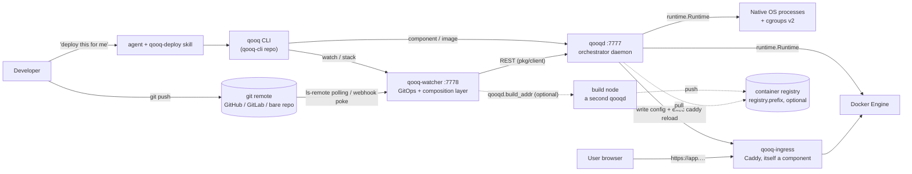
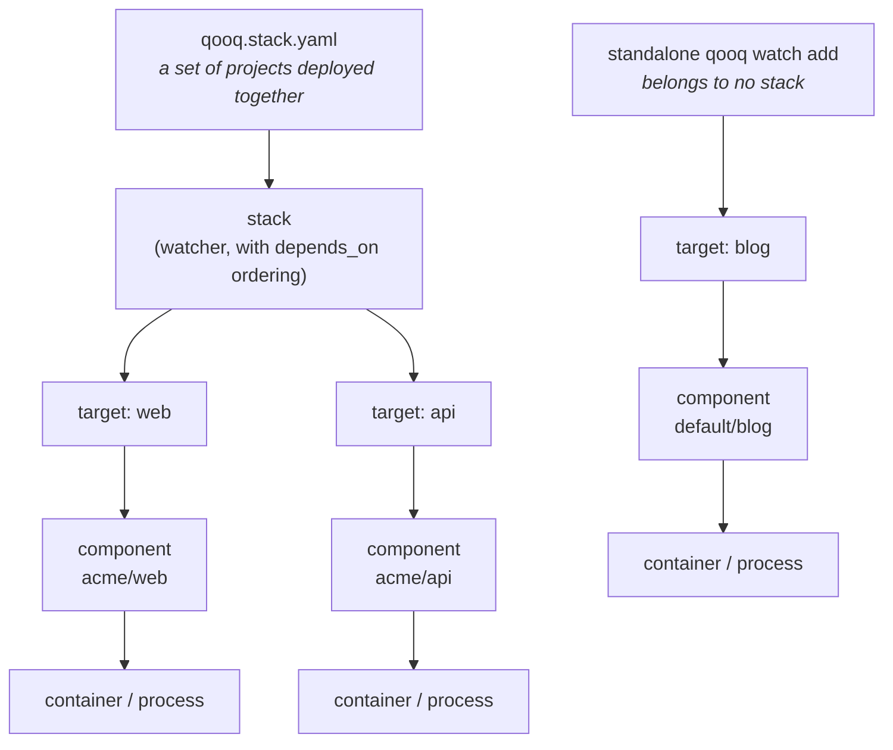
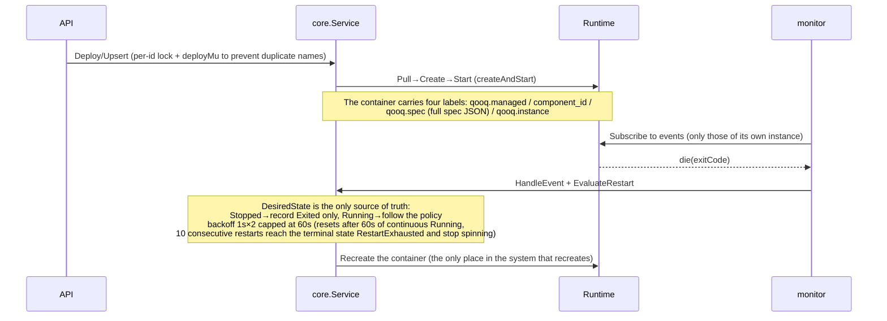
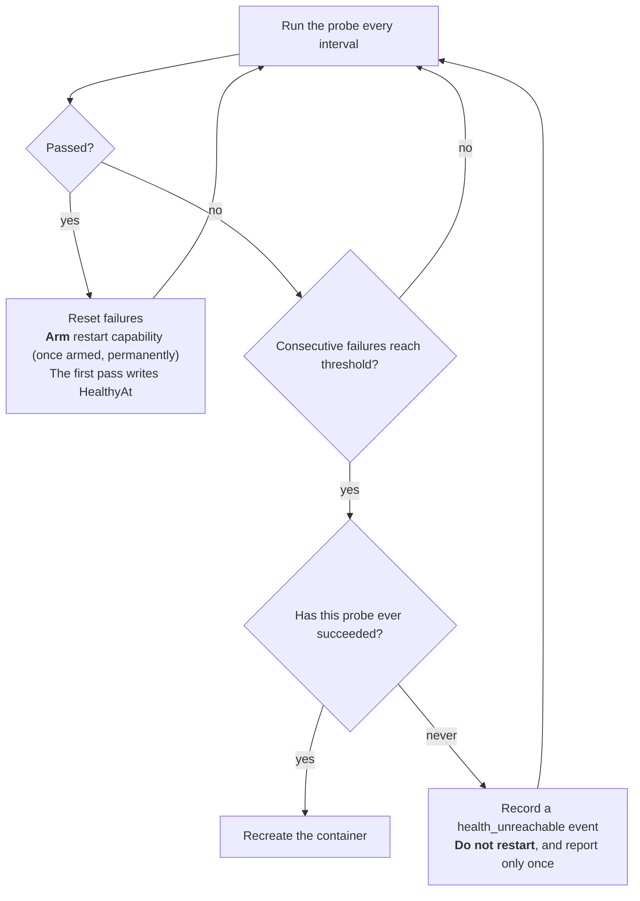
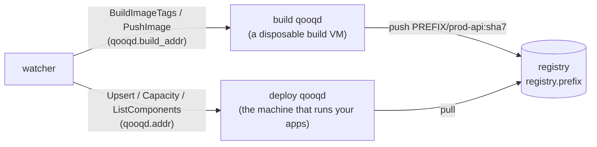
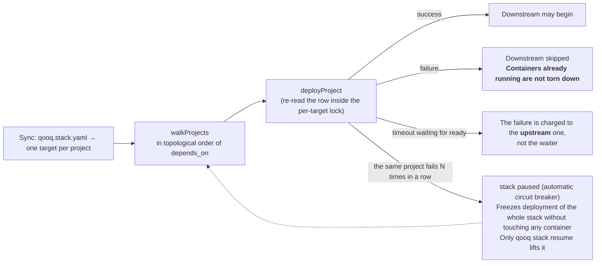
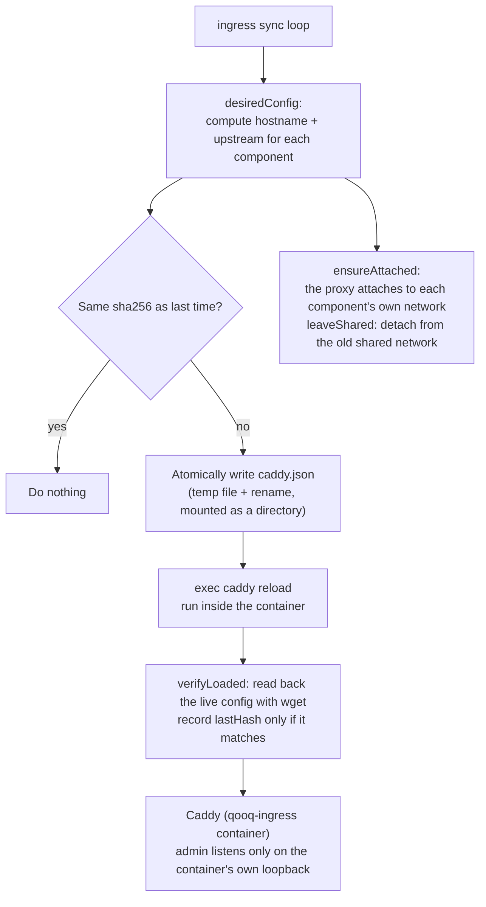

# qooq Architecture Overview

English | [繁體中文](ARCHITECTURE.zh-TW.md)

*System architecture for whoever takes over maintenance (human or AI session): module map, dependency walls, key flows, security model.*

> Written on 2026-07-07 (after M0-M16 were complete), **updated 2026-11-18** (branch `main`).
> This document **describes only what actually exists on `main`**: `qooqd`, `qooq-watcher`, and the `qooq` CLI (in qooq-cli).
> For the operations guide see [USAGE.md](USAGE.md).

## System Context



Three entry points: **the operator types CLI commands**, **the watcher watches git**, and **the skill operates the CLI on a person's behalf**, all against the same daemon.
The skill has no privileged path of its own: it is simply a user that writes `qooq.yaml` and calls the CLI. Dotted lines are optional:
the build node and registry are off by default, and on a single machine the built image just lands in the daemon that runs it.

In one plain sentence: **qooqd is a mini k8s for a single VM**, and **qooq-watcher is its mini ArgoCD + docker-compose**.

## The Three-Layer Model (understand this and the rest is detail)



| Layer | Lives in | What it is | Who creates it |
|---|---|---|---|
| **stack** | watcher DB | Deployment order and shared settings for a set of projects | `qooq stack add` (reads `qooq.stack.yaml`) |
| **target** | watcher DB (sqlite) | "Watch this repo/branch (or image, or uploaded source); when it changes, build and deploy it as that component" | `qooq watch add`, or generated automatically from a stack project |
| **component** | qooqd's bbolt | Something that should be running (image + ports + env + health + …) | The watcher's upsert, or `qooq component deploy` |

> [!IMPORTANT]
> **One stack project = one target** (`desiredProjectTarget` in `internal/watcher/stack_sync.go`).
> It is not a separate pipeline, so manifest, services, mounts, and auto-detection all work as before.
> **A stack project's target does not enter `dueTargets`** (`store.go` excludes `stack_name`); otherwise it would be deployed out of order.

**A component's identity is `(namespace, name)`, not name.** An empty namespace is always stored as `default`
(`pkg/client.NormalizeNamespace`, shared by the daemon, watcher, and CLI). A stack's name is its namespace.

## Module Map and Dependency Walls

```text
cmd/qooqd ──► internal/api ──► internal/core ──► runtime.Runtime (interface)
                    │               │                 ├── internal/runtime/docker
                    │               │                 └── internal/runtime/process
                    │               └──► core.Store (interface) ──► internal/store/bbolt
                    └──► internal/ingress (route computation + config writing + network attachment)
internal/monitor ──► runtime.Runtime + core.Service (events / stats / health goroutines)

cmd/qooq-watcher ──► internal/watcher (fx + weedbox) ──► pkg/client, pkg/buildctx, pkg/manifest,
                     (sqlite_module.go / db_module.go pick the driver)  pkg/watcherclient

pkg/client         SDK + wire DTOs for qooqd (single source of truth; zero internal dependencies)
pkg/watcherclient  SDK + wire DTOs for the watcher (internal/watcher points back to it with type aliases)
pkg/manifest       qooq.yaml format and auto-detection (also used by the CLI for offline validation)
pkg/buildctx       build context packaging
pkg/blobstore      where qooq's own large files go (currently wired only to backups)
pkg/skills         the bundled agent skill (go:embed; the CLI imports it rather than carrying its own copy)
internal/version   version string injected from git describe

../qooq-cli (separate repo) ── replace ../qooq; the CLI on the main branch pairs with qooq's main
```

> [!IMPORTANT]
> **Hard dependency walls** (self-checked by `make check`; any grep that produces output fails the check, see `check:` in the `Makefile`):
> 1. `internal/core`, `internal/api`, and `internal/monitor` never import the docker SDK. This is the stronghold of engine neutrality.
> 2. `cmd/qooqd` does not touch the watcher ecosystem (gin/fx/gorm/go-git/yaml.v3). Anything shared across the wall goes through `pkg/`.
> 3. **Zero CGO across the whole repo** (`CGO_ENABLED=0 go build ./...`; sqlite uses glebarez/modernc).
>
> There is also a shell check: a variable must not be directly followed by a full-width character (bash would merge it into the variable name); and `gofmt -l` must be empty.

> [!NOTE]
> **When you change the wire DTOs or signatures in `pkg/client`, `pkg/watcherclient`, or `pkg/buildctx`,
> also run `make -C ../qooq-cli build`.** The CLI lives in another repo, so this repo's `go build ./...` will not notice it breaking.

A deliberate trade-off: **two coding styles in one repo**. qooqd = chi/slog/bbolt with manual wiring; the watcher = fx +
the generic `weedbox.Module[P]`. Neither is a mistake; their needs differ, and the cost is that maintainers must know both sets of conventions.

## Shared-Machine Options

The mechanisms below do not change behavior by default (names in the `default` namespace are unchanged by a single character).
They matter when several people share one machine or one watcher, or when you build repos you do not fully trust.

- **All names carry the namespace**: container names, ingress hostnames, mounts subtree, default network, group, image repo, and
  artifact directory. **`default` always stays as it was.**
- **Per-namespace secret store** (`internal/watcher/secrets.go`): `${secret.NAME}` first looks in the store for
  `(namespace, name)`, then falls back to the process env; `secrets.allow_process_env` governs both `${env.*}` and
  that fallback, and it should be turned off when several people share one watcher (the single-user default is on, since that is your own environment).
- **`untrusted_repos`** (`internal/watcher/trust.go`, one switch, off by default): rejects `build.command`, tightens mounts to
  `repo-only`, and turns off `${env.*}`. The environment of `build.command` **always** filters out the `QOOQ_` prefix (verified: it could read the decryption key).
- **The ingress proxy attaches to each component's own network** (`ensureAttached` / `leaveShared` in
  `internal/ingress/ingress.go`), instead of putting all components on the single `qooq-ingress` network.
- **`-publish-ip`** (`cmd/qooqd/main.go`, `QOOQ_PUBLISH_IP`, default 0.0.0.0): set it to `127.0.0.1` on a shared machine,
  to avoid ports being opened to every container through the bridge gateway; the proxy's own 80/443 are explicitly written as `0.0.0.0` in the spec.
- **Site-wide container limits** (`limits.default_*` / `max_*` in `internal/watcher/limits.go`, reject rather than clamp) plus
  qooqd's machine-level fuse `-container-memory-max` / `-container-cpus-max` (`internal/core/containerlimits.go`).
  When no restart policy is specified, qooqd always treats it as `always` (see key flow 1).

## Key Flows
### 1. Deploy and self-healing (inside qooqd)



> [!IMPORTANT]
> Four rules hold up concurrency correctness (understand them before changing anything):
> - **per-id lock**: every mutation of the same component (API/monitor/reconcile/restart/orphan adoption) takes it first.
> - **Re-read after taking the lock**: the snapshot from an outer list is stale, and writing it back would overwrite someone else's CrashCount/RestartCount.
> - **deployMu is a leaf only**: a short critical section for the name-uniqueness check; never take a per-id lock while holding it (prevents deadlock).
> - **Single writer**: only `EvaluateRestart`/`performRestart` recreate containers; the monitor's die events,
>   the 15s `ReconcileLoop`, and the health checker's failure threshold are all just "triggers".

**The restart policy default is `always`** (since 2026-11-12; it used to be `no`).

**When a health probe is allowed to restart** (`healthTracker` in `internal/monitor/health.go`):



> [!IMPORTANT]
> **A probe that has never passed is evidence that "the probe cannot see the app", not evidence that "the app is broken".**
> Restarting on it would just recreate a healthy container forever. The message distinguishes the two failure kinds, host port and container IP (the fixes are opposite).
> The reverse does not hold: **paths that have succeeded before must keep their original behavior.**
> `HealthyAt` (`core.Service.NoteHealthy`) is the gate for the watcher's "deploy the app only once the service is ready",
> and also the basis for checking after deployment whether the new version came up (`waitForNewVersion` in `internal/watcher/newversion.go`).

**Orphan adoption**: the `qooq.spec` label stores the complete ComponentSpec, so when the database has been deleted but containers are still around,
qooqd adopts them back at startup (`adoptOrphan` in `reconcile.go`). Teardown **must delete containers first, then the database**.
When starting a second qooqd on the same machine (for example a build node test), **you must use a different `-instance`**, or they will adopt each other's containers.

### 2. GitOps: one sweep of a target

**The sweep only detects; builds are run by workers**: each 10s tick finds the due targets and dispatches them to a pool of workers
(default 3, `sweep.workers`). **The queue is the `targets` table**; no broker is deliberately introduced.
Invariant: the same target never runs concurrently. In-process this is `targetLocks`, and there is another layer, a lease written in the row
(`internal/watcher/claim.go`, a conditional UPDATE, designed for several watchers sharing one postgres; the same mechanism on sqlite, effectively a no-op on a single machine);
a stack uses its own worker and runs strictly one pass at a time; stack-owned targets do not enter the regular queue.

**Build slots**: `sweep.builds_per_namespace` blocks at enqueue (`internal/watcher/queue.go`);
by namespace (`buildGroupOf` in `sweep.go`). 0/unset = unlimited, which is the right default for a single machine.

```text
Detect (source: ls-remote comparing the branch head / image: comparing the registry digest / upload: wait for an upload)
  → Obtain the source (depth-1 clone; token / ssh-key / upload extraction)
  → Obtain the manifest: the repo's qooq.yaml / if absent, auto-detect and generate one (stored; the operator may edit it)
  → inputs check → ${...} interpolation → requests validation → limits cap check
  → services: declared databases are first ensured to exist and be ready (the password is generated once and never changes)
  → Branch: container → POST /v1/images/build (sent to the build node; tag = imageRepo(ns,comp):sha7;
                       with a registry, the remote tag is built too and pushed)
          process   → run build.command → copy the artifact to artifacts/<ns-comp>/<sha7>/
  → Materialize mounts → PUT /v1/components (upsert, recording previous_image)
  → Verify the new version came up (waitForNewVersion; automatic rollback if it did not)
  → Update the target (last_commit advances only on success)
Failure: the same revision backs off 1→2→4… minutes (capped at 1h) before retrying, while a new commit builds immediately; 10 consecutive failures → give up and pause
     (failures not caused by the repo, such as qooqd being unreachable or low disk, are neither counted nor backed off)
```

### 3. Build node, registry, and disk defenses



- **Build node** (`internal/watcher/buildnode.go`): an empty `build_addr` = build and deploy share the same client
  object. Only build and push go to the build node; **`Capacity` always asks the deploy machine** (asking the wrong one would pass the capacity check against the wrong machine).
  Image cleanup goes through `imageHosts()`, and both machines hold a copy.
- **Registry mode** (`internal/watcher/registry.go`, enabled only when `registry.prefix` is non-empty, off by default): one build
  produces two tags, a push failure = the whole build fails, and deployment uses the remote ref.
- **This contains the blast radius** (the build VM holds none of the apps you run); it is not build fairness between users.
  It has been verified on two real Linux VMs.
- **qooqd's build limits are flags, not request fields** (`cmd/qooqd/main.go`, which also reads `QOOQ_BUILD_*` env): a limit the submitter can
  raise is not a limit. `-build-timeout` (default 30m, the only one on by default; a timeout returns 504 `core.ErrBuildTimeout`
  and actually kills the running step container), `-build-memory` / `-build-cpus`, `-build-cache-max` (prune runs via defer,
  so failed builds are cleaned too), `-build-image-max` (exceeding it returns 413 `ErrImageTooLarge`), and
  `-build-min-free-disk` + `-build-disk-path` (insufficient space returns 507 `ErrLowDisk`). Failed builds leave no debris either
  (`ForceRemove` in `internal/runtime/docker/build.go`). Build output keeps the last 64 KiB, which is also available on failure.

### 4. Stack: walking through depends_on



> [!NOTE]
> `${project.web.host}` **has only `.host`** (= the short name, resolved through the container network alias). For addresses across projects use
> `${component.<name>.<field>}` (`internal/watcher/crossref.go`, limited to the same namespace).

### 5. Ingress: how a component becomes a URL



The things most easily gotten wrong, all caught only by e2e:

- **Upstreams use container aliases, not IPs**, because the IP changes on every container recreation.
- **The certificate list is deduplicated by hostname, not by route**: if the same host appears in two automation policies,
  Caddy **rejects the entire config**.
- **A route with a `path` must be ordered before one without**, because Caddy takes the first match.
- **The admin API opens on no network interface and publishes no port**, because it can rewrite every route. Before 2026-09-07 it listened on
  `0.0.0.0:2019`, and any component could rewrite other people's routes. **The question to ask is "who is on the same network as it", not "who on the host can reach it".**
- **The config file is mounted into the proxy as a "directory", not a single file** (2026-11-11): a single-file bind mount follows the inode,
  and after rename swaps the inode, on Linux the container reads the first version forever; every reload exits 0 while the routes are empty.
  **OrbStack reads by path, so this cannot be reproduced on a Mac**, hence `verifyLoaded` was added.
- **The proxy attaches to each component's network**; a component with no network is still attached to `qooq-ingress`.

`qooq-ingress` is itself an ordinary component, so restart/logs/reconcile all apply for free;
it does not enter the routing table itself.

## Naming and Addressing

| Thing | Rule | Why |
|---|---|---|
| Component identity | `(namespace, name)`; an empty namespace is stored as `default` | Two stacks can each have an `api` |
| Name validity | Both namespace and name must be DNS labels | They become a segment of the hostname |
| Container name | `name` (default) / `namespace_name` (`core.ContainerName`) | **default deliberately gets no prefix**: renaming an existing container would leave the ingress alias on the old name unrecoverable |
| hostname | `name.localhost`, `name.<advertise-ip>.nip.io` (non-default carries the namespace; `internal/ingress/hostnames.go`) | Same as above |
| advertise host | `-advertise-host`; detected if not set, re-checked every minute | Detection is heuristic, so **startup always logs which one was chosen** |
| host port | `auto:<port>` is allocated by qooqd (`internal/core/ports.go`); a redeploy gets the same one back | An auto-allocation whose address changes is worse than none |

## Semantics of the Two Runtimes Compared


| Concept | docker | process |
|---|---|---|
| image | registry ref / tag produced by a build | absolute path of a host executable |
| Resource limits | HostConfig.Resources | cgroups v2 (Linux only; swap pinned to 0 for a hard cap) |
| Isolation | container | **None** (shared fs/network, decided for v1; unusable when shared by several people, and `untrusted_repos` blocks `build.command`) |
| mounts | docker `HostConfig.Mounts` | files copied, directories symlinked |
| Network aliases | container network alias | **None** (`network:`/ingress do not apply) |
| Crash detection | docker events | cmd.Wait / a 2s poller for adopted processes (exit is always -1) |
| Daemon restart | containers unaffected, reconcile adopts | processes unaffected, adopted by pid+starttime key |


## State and Persistence

The split follows "what this data is": desired (what should run, who owns it) moves up, observed (container id, restart count, health time)
stays local to the node.

| Data | Where | Notes |
|---|---|---|
| component / group / event | qooqd's bbolt (`qooq.db`) | **Deliberately not replaced** (evaluated) |
| target / stack / inputs / secrets | the watcher's sqlite (`watcher.db`, pure Go) | Credentials are AES-256-GCM once `secret.key` is set (`enc:v2:` = PBKDF2; old `enc:v1:` and plaintext are still readable). The watcher also supports `database.driver=postgres` (`cmd/qooq-watcher/db_module.go`), which is only needed when several watchers share one database |
| App data (`run.volumes`, services' DBs) | **Directories** under `mounts.dir/<ns>/…` | Not docker volumes; **removing a project deletes them too** |
| Injected files (`run.files`) | `mounts.dir/…/<sha7>/` | Versioned by commit, the latest 2 are kept |
| Uploaded source (`deploy_mode: upload`) | the watcher's `uploads.dir/<target>/` | The latest 2 are kept per target |
| Most recent build output | `Target.LastBuildLog` | Only the latest is stored, `GET /v1/targets/{name}/build-log` |
| process instance state | `<proc-dir>/<id>/meta.json` + stdout/stderr.log | Log capped at 10MB |
| build artifact | the watcher's `artifacts/<ns-comp>/<sha7>/` | Keeps current + previous |
| Scheduled backups | qooqd `-backup-dir` / watcher `backup.dir` | `pkg/blobstore` is the interface for where they land |

**Images**: on a single machine, built images simply sit in the local docker daemon, and the `qooq.built=true` label is the only ownership marker;
when build and deploy are on two machines, they go through a registry (see key flow 3).

## Security Model

- qooqd and the watcher bind only `127.0.0.1` by default, each with an optional Bearer token; with no token, `/v1` gets a Host-header guard.
  **Binding beyond loopback without a token warns at startup** (`cmd/qooqd/warn.go`).
- **The webhook endpoint is deliberately exempt from the token**: the watcher's `/v1/webhook/{name}` verifies signatures with HMAC (GitHub) / a shared token (GitLab).
- Private repos use `--auth-token` or `--auth-ssh-key`.
- For the isolation-related switches see "Shared-Machine Options".

> [!WARNING]
> The backup endpoints contain all state (the watcher's also contains credentials), so **set at least one of the token and `secret.key`**.

> [!WARNING]
> **An operator creating a watch target = trusting that repo**: the Dockerfile and `build.command` are both repo-controlled code execution.
> That is fine for one person on one machine; to let repos from people you do not trust in, you must turn on `untrusted_repos`, turn off `secrets.allow_process_env`, and
> set up a build node and build limits (prerequisites for a shared deployment).

- Path traversal is blocked in two layers (`filepath.IsLocal` + the symlink layer `resolveWithin`); credentials are masked in error messages and logs.

## Release and Versioning

- Pushing a `v*` tag → `release.yml` runs `make check` + `make test` → goreleaser (**pinned to v2.5.1**) produces
  linux/darwin × amd64/arm64, containing `qooqd` and `qooq-watcher`. The workflow has a
  `git merge-base --is-ancestor $GITHUB_SHA origin/main` gate: **tags are not bound to a branch**, and a `v*` pushed on another branch
  would publish unreviewed content as an official release.
- Versions are always injected (`internal/version` ← `git describe`). **A `-dirty` version proves nothing about what is inside.**
- `install.sh` installs all three executables in one script and verifies checksums; start/stop with `qooq up/down/status`; start at boot with `qooq service install`.
- **The skill has two install paths, sharing `pkg/skills/qooq-deploy/`**: the Claude Code plugin (`.claude-plugin/`) and
  `qooq skill install --agent claude|codex|cursor|agents`.

## Verification

| Command | What it tests | Needs | In CI |
|---|---|---|---|
| `make check` | vet + gofmt + **three dependency walls** + zero CGO + shell full-width characters | none | ✅ |
| `make test` | `go test -race ./...` (107 `_test.go` files across the repo) | none | ✅ |
| `make install-test` | **actually runs `install.sh`** against a local stand-in server | none | ✅ |
| `make smoke` | End to end: real docker, real git, real HTTP, including stop/start, pause, rm | docker | ❌ (about 4 minutes) |
| `make smoke-multi` | **Three mutually dependent projects**: cross-component references, auto port, service, health | docker | ❌ (about 2-3 minutes) |
| `make smoke-examples` / `smoke-templates` | Actually deploys/builds every `examples/` entry and every built-in template | docker | ❌ |
| `make vuln` | govulncheck | none | ❌ (two findings have no upstream fix; making it a gate would just stay red) |

> [!NOTE]
> **Run `smoke-multi` when you touch watcher / ports / health / interpolation**: a whole class of bugs shows up only in the multi-project shape.
> Before verifying, make sure you are verifying the code you changed (traps include rebuilding, `-dirty`, CLI symlinks, and control loops that revert the scene).

## Related Documents

- [USAGE.md](USAGE.md): operations guide (including quick starts for GitOps, ingress, and stack)
- [DEPLOY-CONFIG.md](DEPLOY-CONFIG.md): `qooq.yaml` field reference (the user-facing single source of truth)
