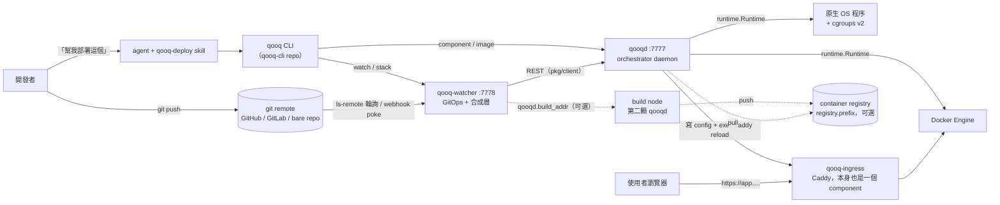
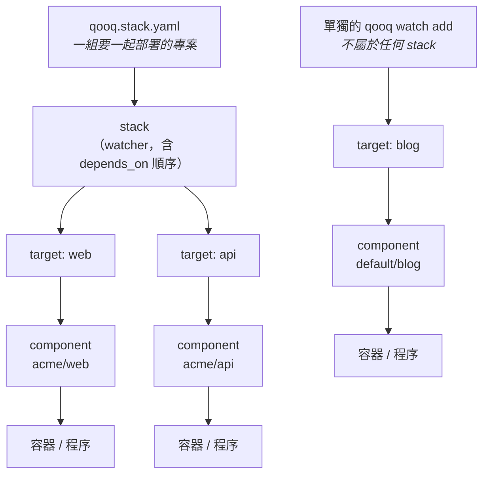
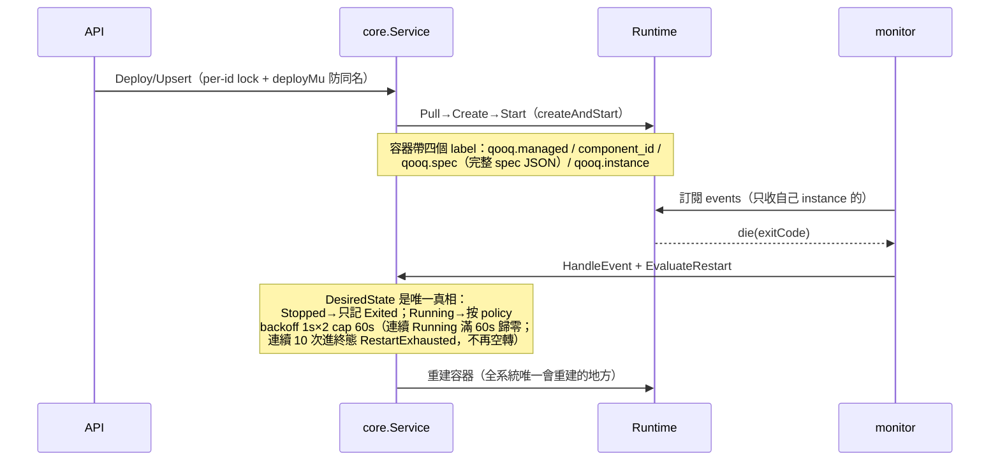
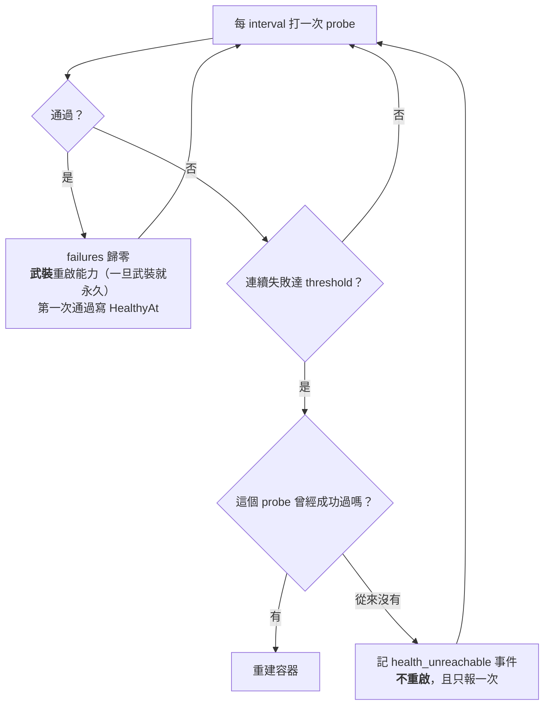
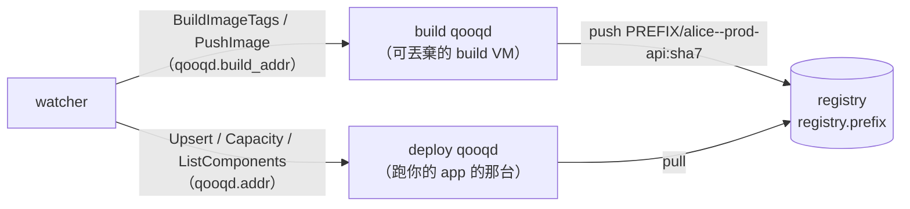
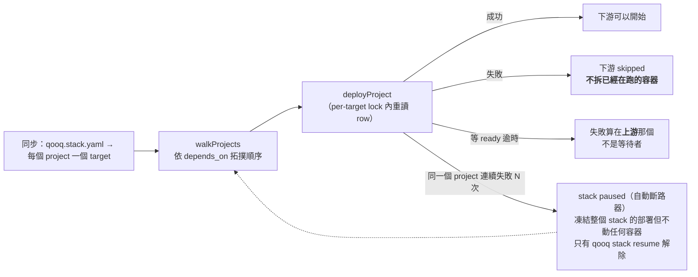
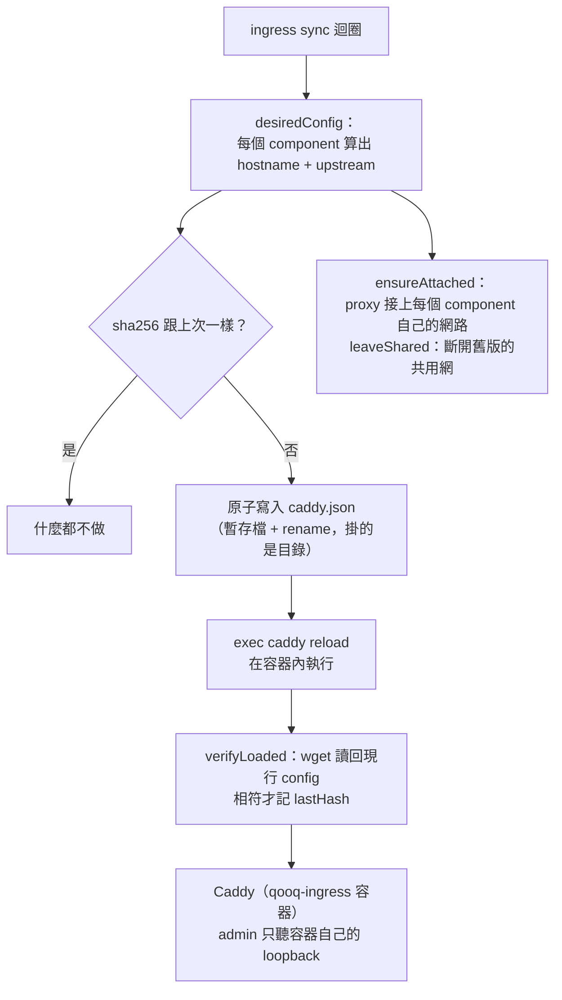

# qooq 架構總覽

[English](ARCHITECTURE.md) | 繁體中文

*給接手維護的人（或 AI session）看的系統架構：模組地圖、依賴牆、關鍵流程、安全模型。*

> 寫於 2026-07-07（M0–M16 完成後），**2026-11-18 更新**（分支 `main`）。
> 本檔**只描述 `main` 上實際存在的東西**：`qooqd`、`qooq-watcher`、`qooq` CLI（在 qooq-cli）。
> 操作手冊見 [USAGE.md](USAGE.zh-TW.md)。

## 系統上下文



三個入口：**operator 打 CLI**、**watcher 看著 git**、**skill 代替人操作 CLI**，同一個 daemon。
skill 沒有自己的特權路徑——它就是一個會寫 `qooq.yaml` 並呼叫 CLI 的使用者。虛線是可選的：
build node 與 registry 預設關，單機時 build 出來的 image 就落在跑它的那顆 daemon 裡。

一句白話：**qooqd 是單 VM 上的迷你 k8s**，**qooq-watcher 是它的迷你 ArgoCD + docker-compose**。

## 三層模型（先懂這個，其餘都是細節）



| 層 | 住在哪 | 是什麼 | 誰建立 |
|---|---|---|---|
| **stack** | watcher 的 DB | 一組專案的部署順序與共用設定 | `qooq stack add`（讀 `qooq.stack.yaml`） |
| **target** | watcher 的 DB（sqlite） | 「盯著這個 repo/branch（或 image、或上傳的原始碼），變了就 build 並部署成那個 component」 | `qooq watch add`，或 stack 依 project 自動生成 |
| **component** | qooqd 的 bbolt | 一個該在跑的東西（image + ports + env + health + …） | watcher 的 upsert，或 `qooq component deploy` |

> [!IMPORTANT]
> **一個 stack 的 project = 一個 target**（`internal/watcher/stack_sync.go` 的 `desiredProjectTarget`）。
> 它不是另一條 pipeline，所以 manifest、services、mounts、自動偵測全部照舊生效。
> **stack 的 project target 不進 `dueTargets`**（`store.go` 排除 `stack_name`），否則會被亂序部署。

**component 的身分是 `(namespace, name)`，不是 name。** namespace 沒填一律存 `default`
（`pkg/client.NormalizeNamespace`，daemon/watcher/CLI 三邊共用）。stack 名就是它的 namespace。

## 模組地圖與依賴牆

```text
cmd/qooqd ──► internal/api ──► internal/core ──► runtime.Runtime (interface)
                    │               │                 ├── internal/runtime/docker
                    │               │                 └── internal/runtime/process
                    │               └──► core.Store (interface) ──► internal/store/bbolt
                    └──► internal/ingress（路由計算 + 寫 config + 接網路）
internal/monitor ──► runtime.Runtime + core.Service（events / stats / health goroutines）

cmd/qooq-watcher ──► internal/watcher（fx + weedbox）──► pkg/client、pkg/buildctx、pkg/manifest、
                     （sqlite_module.go／db_module.go 選 driver）  pkg/watcherclient

pkg/client         qooqd 的 SDK + wire DTO（單一真相來源；零 internal 依賴）
pkg/watcherclient  watcher 的 SDK + wire DTO（internal/watcher 用 type alias 指回來）
pkg/manifest       qooq.yaml 的格式與自動偵測（CLI 離線驗證也用）
pkg/buildctx       build context 打包
pkg/blobstore      qooq 自己的大檔去哪（目前只接備份）
pkg/skills         隨附的 agent skill（go:embed；CLI import 它而不是自帶副本）
internal/version   git describe 注入的版本字串

../qooq-cli（獨立 repo）── replace ../qooq；main 分支的 CLI 配 qooq 的 main
```

> [!IMPORTANT]
> **硬依賴牆**（`make check` 自檢，任何一條 grep 有輸出就失敗，見 `Makefile` 的 `check:`）：
> 1. `internal/core`、`internal/api`、`internal/monitor` 永不 import docker SDK——engine 中立性的根據地。
> 2. `cmd/qooqd` 不沾 watcher 生態（gin/fx/gorm/go-git/yaml.v3）。跨牆共享一律走 `pkg/`。
> 3. **全 repo 零 CGO**（`CGO_ENABLED=0 go build ./...`；sqlite 用 glebarez/modernc）。
>
> 另有一條 shell 檢查：變數後面不得直接接全形字元（bash 會併進變數名）；以及 `gofmt -l` 必須為空。

> [!NOTE]
> **改 `pkg/client`、`pkg/watcherclient`、`pkg/buildctx` 的 wire DTO 或簽名時，
> 要順手跑 `make -C ../qooq-cli build`**——CLI 在另一個 repo，本 repo 的 `go build ./...` 不會發現它壞了。

刻意的取捨：**同 repo 兩種寫法**。qooqd＝chi/slog/bbolt 手動 wiring；watcher＝fx +
`weedbox.Module[P]` 泛型。不是誰寫錯了，是各自的需求不同，代價是維護者要會多套慣例。

## 共用機器的相關選項

下面這些機制預設不影響行為（`default` namespace 的名字一個字沒變）。
多人共用一台機器或一台 watcher、或要建不完全信任的 repo 時才需要。

- **名字全部帶 namespace**：容器名、ingress hostname、mounts 子樹、預設 network、group、image repo、
  artifact 目錄。**`default` 一律保持原樣**。
- **per-namespace secret store**（`internal/watcher/secrets.go`）：`${secret.NAME}` 先查
  `(namespace, name)` 的 store，再退回 process env；`secrets.allow_process_env` 同時管 `${env.*}` 與
  那條退路，多人共用一台 watcher 時應該關（單人預設開，那就是你自己的環境）。
- **`untrusted_repos`**（`internal/watcher/trust.go`，一個開關，預設關）：拒絕 `build.command`、mounts 收緊成
  `repo-only`、關掉 `${env.*}`。`build.command` 的環境**永遠**濾掉 `QOOQ_` 前綴（實測過能讀到解密金鑰）。
- **ingress 由 proxy 去接每個 component 自己的網路**（`internal/ingress/ingress.go` 的
  `ensureAttached`／`leaveShared`），不再讓所有 component 同在 `qooq-ingress` 一張網上。
- **`-publish-ip`**（`cmd/qooqd/main.go`，`QOOQ_PUBLISH_IP`，預設 0.0.0.0）：多人共用機器時設 `127.0.0.1`，
  避免 port 經 bridge gateway 對每個容器都開；proxy 自己的 80／443 在 spec 裡明寫 `0.0.0.0`。
- **全站容器上限**（`internal/watcher/limits.go` 的 `limits.default_*`／`max_*`，拒絕不壓低）＋
  qooqd 的機器層保險絲 `-container-memory-max`／`-container-cpus-max`（`internal/core/containerlimits.go`）。
  restart policy 未指定時 qooqd 一律當 `always`（見關鍵流程 1）。

## 關鍵流程
### 1. 部署與自動修復（qooqd 內部）



> [!IMPORTANT]
> 四條規則撐起併發正確性（改動前務必理解）：
> - **per-id lock**：對同一 component 的一切變更（API/monitor/reconcile/restart/孤兒認領）都先拿它。
> - **拿到鎖後重讀**：外層 list 的快照過期了，寫回去會蓋掉別人的 CrashCount/RestartCount。
> - **deployMu 只當 leaf**：name 唯一性檢查的短臨界區，絕不持有它時再拿 per-id lock（防死鎖）。
> - **單一 writer**：只有 `EvaluateRestart`/`performRestart` 會重建容器；monitor 的 die event、
>   15s 的 `ReconcileLoop`、health checker 的失敗門檻，全部只是「觸發源」。

**restart policy 預設是 `always`**（2026-11-12 起，以前是 `no`）。

**health probe 什麼時候才准重啟**（`internal/monitor/health.go` 的 `healthTracker`）：



> [!IMPORTANT]
> **一次都沒通過過的 probe，是「probe 看不到 app」的證據，不是「app 壞了」的證據。**
> 照重啟只會把好容器重建到天荒地老。訊息會分辨 host port 與容器 IP 兩種失敗（修法相反）。
> 反向不成立：**曾經成功過的路徑必須維持原行為**。
> `HealthyAt`（`core.Service.NoteHealthy`）是 watcher「服務 ready 才部署 app」的那道門，
> 也是部署後驗證新版有沒有起來的依據（`internal/watcher/newversion.go` 的 `waitForNewVersion`）。

**孤兒認領**：`qooq.spec` label 存著完整的 ComponentSpec，所以資料庫刪了、容器還在的時候，
qooqd 開機會把它們認領回來（`reconcile.go` 的 `adoptOrphan`）。teardown **一定要先刪容器再刪資料庫**。
在同一台機器起第二顆 qooqd（例如 build node 測試）**一定要不同的 `-instance`**，否則會互相認領。

### 2. GitOps：一個 target 的一輪 sweep

**sweep 只偵測，build 由 worker 跑**：10s tick 查出 due targets 就派給一組 worker
（預設 3，`sweep.workers`）。**佇列就是 `targets` 表**，刻意不引入 broker。
不變式：同一 target 永不並行——行程內是 `targetLocks`，另有一層寫在 row 裡的 lease
（`internal/watcher/claim.go`，條件式 UPDATE，為多個 watcher 共用 postgres 而設；sqlite 上同一套，單機是 no-op 級別）；
stack 走自己的 worker 且嚴格一次一趟；stack-owned target 不進一般佇列。

**建置名額**：`sweep.builds_per_namespace` 擋在 enqueue（`internal/watcher/queue.go`）；
按 namespace 算（`sweep.go` 的 `buildGroupOf`）。0／未設＝不限，這是單機的正確預設。

```text
偵測（source：ls-remote 比對 branch head ／ image：比對 registry digest ／ upload：等上傳）
  → 取得原始碼（depth-1 clone；token／ssh-key／upload 解壓）
  → 取得 manifest：repo 的 qooq.yaml ／ 沒有就自動偵測生成一份（存起來，operator 可改）
  → inputs 檢查 → ${...} 插值 → requests 驗證 → limits 上限檢查
  → services：宣告的資料庫先確保存在且 ready（密碼生成一次後永久不變）
  → 分支：container → POST /v1/images/build（送到 build node；tag = imageRepo(ns,comp):sha7；
                       有 registry 就同時打 remote tag 並 push）
          process   → 跑 build.command → artifact 複製到 artifacts/<ns-comp>/<sha7>/
  → mounts 物化 → PUT /v1/components（upsert，記 previous_image）
  → 驗證新版起來了（waitForNewVersion，沒起來就自動回滾）
  → 更新 target（last_commit 只在成功時前進）
失敗：同一版退避 1→2→4…分鐘（上限 1h）再重試，新 commit 立刻建；連續 10 次 → 放棄並 pause
     （不是 repo 造成的失敗——qooqd 連不上、磁碟不足——不計數不退避）
```

### 3. 建置節點、registry 與磁碟防線



- **build node**（`internal/watcher/buildnode.go`）：`build_addr` 空值＝build 與 deploy 用同一個 client
  物件。只有 build 與 push 走 build node；**`Capacity` 一律問部署機**（問錯會對著錯的機器通過容量檢查）。
  清 image 要走 `imageHosts()`，兩台都有一份。
- **registry 模式**（`internal/watcher/registry.go`，`registry.prefix` 非空才開，預設關）：一次 build
  打兩個 tag、push 失敗＝整個 build 失敗、部署用 remote ref。
- **這圍住的是爆炸半徑**（build VM 上沒有任何你要跑的 app），不是使用者之間的 build 公平性。
  兩台 Linux VM 已實跑驗收。
- **qooqd 的建置上限是旗標不是 request**（`cmd/qooqd/main.go`，也吃 `QOOQ_BUILD_*` env）——送出者自己能
  調高的上限不是上限：`-build-timeout`（預設 30m，唯一預設開的；逾時回 504 `core.ErrBuildTimeout`，
  且真的 kill 正在跑的 step 容器）、`-build-memory`／`-build-cpus`、`-build-cache-max`（prune 走 defer，
  失敗的 build 也會清）、`-build-image-max`（超過回 413 `ErrImageTooLarge`）、
  `-build-min-free-disk`＋`-build-disk-path`（不足回 507 `ErrLowDisk`）。失敗的 build 也不留殘骸
  （`internal/runtime/docker/build.go` 的 `ForceRemove`）。建置輸出留尾巴 64 KiB，失敗時也拿得到。

### 4. stack：按 depends_on 走一遍



> [!NOTE]
> `${project.web.host}` **只有 `.host`**（＝短名，靠容器網路 alias 解析）。跨專案要位址用
> `${component.<名字>.<欄位>}`（`internal/watcher/crossref.go`，限同 namespace）。

### 5. ingress：component 怎麼變成一個網址



最容易寫錯的事，都是 e2e 才抓到的：

- **upstream 用容器 alias 不用 IP**——容器每次重建 IP 就變。
- **憑證清單按 hostname 去重，不是按 route**——同一個 host 出現在兩個 automation policy，
  Caddy 會**整份 config 拒絕**。
- **有 `path` 的 route 必須排在沒有的前面**——Caddy 取第一個 match。
- **admin API 不對任何網路介面開，也不發布 port**——它能改寫全部路由。2026-09-07 以前聽
  `0.0.0.0:2019`，任一 component 都能改寫別人的路由。**要問的是「誰跟它同一張網」，不是「host 上誰打得到」。**
- **設定檔用「目錄」掛進 proxy，不是單一檔案**（2026-11-11）：單檔 bind mount 跟 inode 走，
  rename 換掉 inode 後 Linux 上容器永遠讀第一版，每次 reload 都 exit 0 而路由是空的。
  **OrbStack 照路徑讀，Mac 上驗不出來**，所以補了 `verifyLoaded`。
- **proxy 接每個 component 的網路**；沒有網路的 component 仍接 `qooq-ingress`。

`qooq-ingress` 本身就是一個普通 component，所以 restart/logs/reconcile 全部免費沿用；
它自己不進路由表。

## 命名與定址

| 東西 | 規則 | 為什麼 |
|---|---|---|
| component 身分 | `(namespace, name)`，namespace 空值存 `default` | 兩個 stack 可以各有一個 `api` |
| 名字合法性 | namespace 與 name 都必須是 DNS label | 它們會變成 hostname 的一段 |
| 容器名 | `name`（default）／ `namespace_name`（`core.ContainerName`） | **default 刻意不加前綴**：既有容器改名會讓舊名字上的 ingress alias 補不回來 |
| hostname | `name.localhost`、`name.<advertise-ip>.nip.io`（非 default 帶 namespace；`internal/ingress/hostnames.go`） | 同上 |
| advertise host | `-advertise-host`，沒設就偵測，每分鐘重測 | 偵測是啟發式的，**開機必 log 選了哪個** |
| host port | `auto:<port>` 由 qooqd 配置（`internal/core/ports.go`），重佈拿回同一個 | 位址會變的自動配置比沒有更糟 |

## 兩個 runtime 的語意對照


| 概念 | docker | process |
|---|---|---|
| image | registry ref / build 出的 tag | host 可執行檔絕對路徑 |
| 資源限制 | HostConfig.Resources | cgroups v2（僅 Linux；swap 鎖 0 才是硬上限） |
| 隔離 | container | **無**（共享 fs/網路，v1 拍板；多人共用時不可用，`untrusted_repos` 會擋 `build.command`） |
| mounts | docker `HostConfig.Mounts` | 檔案用複製、目錄用 symlink |
| 網路別名 | 容器網路 alias | **無**（`network:`/ingress 不適用） |
| crash 偵測 | docker events | cmd.Wait／adopted 用 2s poller（exit 一律 -1） |
| daemon 重啟 | 容器不受影響，reconcile adopt | 程序不受影響，pid+starttime key adopt |


## 狀態與持久化

切法是「這份資料是什麼」：desired（該跑什麼、歸誰）往上搬，observed（容器 id、重啟次數、health 時間）
留在 node 本地。

| 資料 | 放哪 | 備註 |
|---|---|---|
| component / group / event | qooqd 的 bbolt（`qooq.db`） | **刻意不換**（已評估） |
| target / stack / inputs / secrets | watcher 的 sqlite（`watcher.db`，純 Go） | credential 設了 `secret.key` 即 AES-256-GCM（`enc:v2:`＝PBKDF2；舊 `enc:v1:` 與明文仍讀得到）。watcher 另支援 `database.driver=postgres`（`cmd/qooq-watcher/db_module.go`），只有多個 watcher 共用同一個資料庫時才需要 |
| app 的資料（`run.volumes`、services 的 DB） | `mounts.dir/<ns>/…` 底下的**目錄** | 不是 docker volume；**移除專案會一起刪** |
| 注入的檔案（`run.files`） | `mounts.dir/…/<sha7>/` | 按 commit 版本化，留最新 2 份 |
| 上傳的原始碼（`deploy_mode: upload`） | watcher 的 `uploads.dir/<target>/` | 每個 target 留最近 2 份 |
| 最近一次建置輸出 | `Target.LastBuildLog` | 只存最近一次，`GET /v1/targets/{name}/build-log` |
| process 實例狀態 | `<proc-dir>/<id>/meta.json` + stdout/stderr.log | log 上限 10MB |
| build artifact | watcher 的 `artifacts/<ns-comp>/<sha7>/` | 保留 current + previous |
| 排程備份 | qooqd `-backup-dir`／watcher `backup.dir` | `pkg/blobstore` 是它的落點介面 |

**image**：單機時 build 出來就躺在本機 docker daemon 裡，`qooq.built=true` label 是唯一的歸屬標記；
build 與部署分開兩台時走 registry（見關鍵流程 3）。

## 安全模型

- qooqd 與 watcher 預設只 bind `127.0.0.1`，各有可選 Bearer token；無 token 時 `/v1` 掛 Host-header guard。
  **綁到 loopback 之外又沒設 token，開機會 warn**（`cmd/qooqd/warn.go`）。
- **webhook 端點刻意豁免 token**：watcher 的 `/v1/webhook/{name}` 靠 HMAC（GitHub）／共享 token（GitLab）驗簽。
- 私有 repo 用 `--auth-token` 或 `--auth-ssh-key`。
- 隔離相關的開關見「共用機器的相關選項」。

> [!WARNING]
> backup 端點含全部狀態（watcher 的還含 credential），**token 與 `secret.key` 至少設一個**。

> [!WARNING]
> **operator 建 watch target = 信任該 repo**：Dockerfile 與 `build.command` 都是 repo 控制的程式碼執行。
> 單人單機沒問題；要讓不信任的人的 repo 進來，必須開 `untrusted_repos`、關 `secrets.allow_process_env`、
> 設 build node 與建置上限（共用部署的前提）。

- 路徑穿越擋兩層（`filepath.IsLocal` + symlink 層 `resolveWithin`）；credential 在錯誤訊息與 log 中遮蔽。

## 發佈與版本

- 打 `v*` tag → `release.yml` 跑 `make check` + `make test` → goreleaser（**釘 v2.5.1**）產
  linux/darwin × amd64/arm64，內容是 `qooqd` 與 `qooq-watcher`。workflow 有一道
  `git merge-base --is-ancestor $GITHUB_SHA origin/main`——**tag 不綁分支**，打在其他分支上的 `v*`
  會把未審的內容發成正式版本。
- 版本一律注入（`internal/version` ← `git describe`）。**`-dirty` 版號證明不了裡面有什麼**。
- `install.sh` 一支裝三個執行檔並驗 checksum；起停 `qooq up/down/status`；開機自啟 `qooq service install`。
- **skill 有兩條安裝路徑，共用 `pkg/skills/qooq-deploy/`**：Claude Code plugin（`.claude-plugin/`）與
  `qooq skill install --agent claude|codex|cursor|agents`。

## 驗證

| 指令 | 測什麼 | 需要 | 在 CI |
|---|---|---|---|
| `make check` | vet + gofmt + **三道依賴牆** + 零 CGO + shell 全形字元 | — | ✅ |
| `make test` | `go test -race ./...`（全 repo 共      107 個 `_test.go`） | — | ✅ |
| `make install-test` | **真的跑 `install.sh`**，對本機 stand-in server | — | ✅ |
| `make smoke` | 端到端：真 docker、真 git、真 HTTP，含 stop/start、pause、rm | docker | ❌（約 4 分鐘） |
| `make smoke-multi` | **三個互相依賴的專案**：跨 component 引用、auto port、service、health | docker | ❌（約 2–3 分鐘） |
| `make smoke-examples`／`smoke-templates` | 每個 `examples/`、每個內建模板真的部署／build 一遍 | docker | ❌ |
| `make vuln` | govulncheck | — | ❌（上游無修復版的兩筆，做成 gate 只會長期紅） |

> [!NOTE]
> **動到 watcher / ports / health / 插值時要跑 `smoke-multi`**——一整類 bug 只在多專案形狀下才現形。
> 驗證前確認你驗的是你改的那份碼（重 build、`-dirty`、CLI symlink、控制迴圈會改回現場等陷阱）。

## 相關文件

- [USAGE.md](USAGE.zh-TW.md) — 操作手冊（含 GitOps、ingress、stack 的快速開始）
- [DEPLOY-CONFIG.md](DEPLOY-CONFIG.zh-TW.md) — `qooq.yaml` 欄位參考（使用者側單一真相來源）
