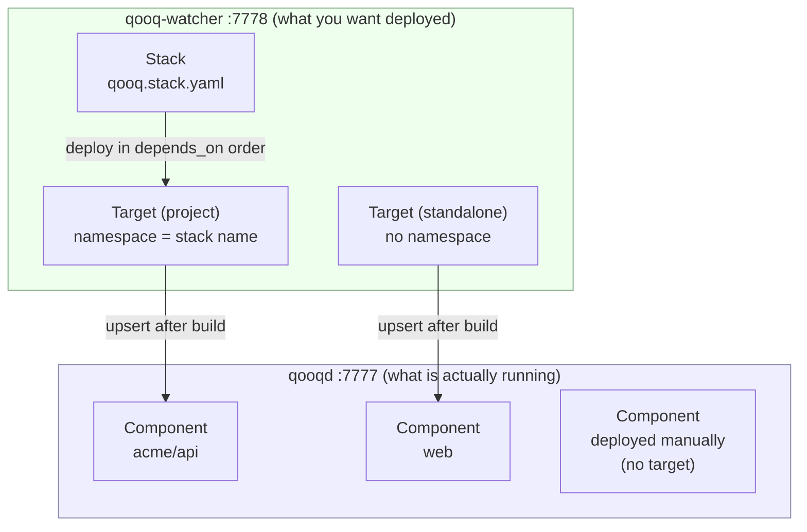

# qooq Usage Guide

English | [繁體中文](USAGE.zh-TW.md)

*Operations manual for the binaries — for someone who has just received this repo: how to build, how to run, and how to go from a git push to an automatically deployed container.*

> For the architecture overview, see [ARCHITECTURE.md](ARCHITECTURE.md); for the `qooq.yaml` field reference, see [DEPLOY-CONFIG.md](DEPLOY-CONFIG.md). This document covers operations only.

## Table of contents

- [The three binaries](#the-three-binaries)
- [How the pieces relate](#how-the-pieces-relate)
- [Install (without building from source)](#install-without-building-from-source)
  - [Start and stop: qooq up / down / status](#start-and-stop-qooq-up--down--status)
  - [Verify the whole chain works: make smoke](#verify-the-whole-chain-works-make-smoke)
- [Build (from source)](#build-from-source)
  - [Two paths for e2e testing](#two-paths-for-e2e-testing)
- [Quick start](#quick-start)
- [Process runtime mode](#process-runtime-mode)
- [Auth and access control](#auth-and-access-control)
- [Sign in with `qooq auth`](#sign-in-with-qooq-auth)
- [Without git: qooq deploy .](#without-git-qooq-deploy-)
- [GitOps auto-deploy](#gitops-auto-deploy)
  - [Stop, pause, remove](#stop-pause-remove)
  - [`--repo` argument format](#--repo-argument-format)
  - [Webhook triggers](#webhook-triggers)
  - [Passing secrets with @file](#passing-secrets-with-file)
  - [App manifest](#app-manifest)
  - [When the repo has no qooq.yaml](#when-the-repo-has-no-qooqyaml)
  - [Image deploy mode](#image-deploy-mode)
  - [Deploying directly from CI](#deploying-directly-from-ci)
- [Stack: deploying several projects at once](#stack-deploying-several-projects-at-once)
- [Backup and restore](#backup-and-restore)
  - [Upgrades and disaster recovery](#upgrades-and-disaster-recovery)
- [FAQ](#faq)
- [Related documents](#related-documents)

## The three binaries

| Binary | Role | Default address |
|---|---|---|
| `qooqd` | Orchestrator daemon: manages deploys, restarts, and health checks of components (containers or native processes) | `127.0.0.1:7777` |
| `qooq` | CLI: sends commands to qooqd and qooq-watcher (**separate repo: [qooq-cli](https://github.com/qooqapp/qooq-cli)**) | — |
| `qooq-watcher` | GitOps service: watches git repos and, on a new commit, builds an image and deploys it to qooqd | `127.0.0.1:7778` |

## How the pieces relate

Two daemons run on one machine: **qooqd** manages containers, and **qooq-watcher** decides *when* to deploy.
Each has its own data. The relationship looks like this:



Three things are enough to understand:

1. **One target maps to one component, and only one.** Both tables print the `NAMESPACE` + `COMPONENT` /
   `NAME` columns (same order, same format); that combination is the only join between the two tables,
   so you can match rows directly.
   A second target pointing at the same component is rejected (409).
2. **A component's full name is `namespace/name`, and every component has a namespace.** If you don't specify one it is
   `default` — that is a real stored value, and the API returns `"namespace":"default"`. The tables split the two halves into two columns
   so you can scan a single column to see "which stack owns what"; when you use the name as an argument, join the halves
   as `acme/api` (this is the form `watch get` prints). `default/api` and `api` both address the same thing.
3. **A stack's namespace is the stack's own name.** `acme/api` means "project `api` in stack `acme`";
   a bare name such as `web` (no slash) is a standalone target or a manual deployment.

How to **set** a namespace:

| How it is created | Argument | Result |
|---|---|---|
| `qooq component deploy/upsert` | `--namespace acme` | The component is named `acme/<name>` |
| `qooq watch add` | `--namespace acme` | The component deployed by this target is named `acme/<component>` |
| `qooq stack add --name acme` | Nothing extra to set | Every project lands in namespace `acme` and network `qooq-acme` automatically |

If you don't set one, it is `default`. `default` is a reserved word; a stack cannot use that name (it is rejected with 400).

There is one exception to `default` to be aware of: **it does not appear in container names or URLs**. A component named
`api` under `default` gets a container named `api` (not `default_api`), and its URL is still `api.localhost` (not
`api.default.localhost`). Only other namespaces get a prefix (`api` under `acme` → container `acme_api`,
URL `api.acme.localhost`). This way existing deployments are not renamed or left with broken routes just because the default value is now filled in.

Also, **component names must now be lowercase DNS labels** (`a-z`, `0-9`, `-`). Older components without a namespace
could use names like `my_app.v2`; that no longer works — a name becomes a DNS alias on the network, and a name that does not
conform to the spec could never be reached by other components on the same network anyway. Existing components do not break because of this,
but their next deploy is rejected and asks for a rename.

```bash
qooq stack ls              # which stacks exist
qooq stack get acme        # each project in this stack: status, depends_on, commit
qooq watch ls              # which targets exist, and which component each deploys to
qooq component ls          # what is actually running (the NAMESPACE column shows which stack it belongs to)
```

> [!NOTE]
> The reverse lookup ("which target deployed this component") can currently only be inferred from names: qooqd **does not know** the watcher exists;
> it only receives "deploy this spec" requests. This layering is deliberate — qooqd works standalone without a watcher.

Both `component ls` and `watch ls` accept `--sort` and `-r`:

```bash
qooq component ls --sort started        # longest-running first
qooq component ls --sort phase -r       # group by status, reversed
qooq watch ls --sort last-build -r      # most recently built first
qooq watch ls --sort namespace          # targets of the same stack together
```

Rows without a namespace always come first (the default sort of `component ls` is also namespace first, then name).

## Install (without building from source)

```bash
sh install.sh

# Install somewhere else (no sudo needed)
PREFIX=~/.local/bin sh install.sh

# Installing from a private fork: a GitHub token with read access
GITHUB_TOKEN=ghp_... QOOQ_REPO=you/qooq QOOQ_CLI_REPO=you/qooq-cli sh install.sh

# When the archive is hosted on your own site / object storage (no token needed)
QOOQ_DOWNLOAD_BASE=https://dl.example.com/qooq/v0.2.0 VERSION=v0.2.0 sh install.sh
```

After installation, all three binaries (`qooqd` / `qooq-watcher` / `qooq`) are on your PATH.

### Start and stop: `qooq up` / `down` / `status`

```bash
qooq up                # start both daemons; all state lives in ~/.qooq (override with QOOQ_HOME)
qooq up --ingress      # also start the reverse proxy (binds :80)
qooq up --no-watcher   # qooqd only
qooq status            # is it running right now
qooq down              # stop both daemons
```

A few things worth knowing:

- **State always lives in `~/.qooq`**: `qooq.db`, `watcher.db`, logs, and pid files are all there. Running
  `qooq up` inside a project directory **does not** leave database files in your repo (a long-standing problem when running the binaries directly).
- **Idempotent**: anything already running is not restarted.
- **If startup fails, the tail of the log is printed**, so you don't have to dig through files.
- **`qooq down` does not stop the components you deployed** — those are docker containers, not child processes of the daemon.
  The next `qooq up` picks them up automatically (orphan adoption).
- **If another process holds the port, it says so clearly** instead of pretending "already running".

> [!NOTE]
> `qooq up` runs the **native processes**; `qooq compose` does the same thing using containers and needs this repo's
> compose file. If both are available, pick one — don't start both (they fight over the same ports).

### Using it from a coding agent: the `qooq-deploy` skill

If you don't want to memorize commands, qooq ships a skill — say "deploy this project for me" and it detects the project type,
writes `qooq.yaml`, starts the daemons, deploys, and **actually curls the endpoint** before handing the URL to you.

**Claude Code, Codex, and Cursor are all supported**, because they read the same format (a directory containing
a `SKILL.md` with `name`/`description` frontmatter, plus `scripts/`). So qooq maintains a single copy of the
content, and `--agent` only decides where it is installed:

| Agent | Command | Installed to |
|---|---|---|
| Claude Code | `qooq skill install qooq-deploy` | `~/.claude/skills/` |
| Codex | `qooq skill install qooq-deploy --agent codex` | `~/.codex/skills/` (`CODEX_HOME` is respected) |
| Cursor | `qooq skill install qooq-deploy --agent cursor` | `~/.cursor/skills/` |
| Shared by both | `qooq skill install qooq-deploy --agent agents` | `~/.agents/skills/`, scanned by both Codex and Cursor |

`--dir` lets you specify the directory directly (for example, to install into a project's own `.agents/skills/` so the whole team follows the repo);
it overrides `--agent`. `qooq skill ls` lists which agents it is currently installed for.

**Script paths in SKILL.md are rendered at install time**: the document must give absolute paths (the agent's working directory is
the user's project, and a relative path cannot reach the skill itself), so whatever location it is installed to is what the document says. For Claude Code
this is an identity transformation, so existing installs are bit-for-bit unchanged.

Claude Code can additionally use the plugin route (this route **does not** require qooq to be installed first; the skill installs its own copy using the repo's `install.sh`):

```
/plugin marketplace add qooqapp/qooq
/plugin install qooq-deploy@qooq
```

Restart the session for it to take effect (reload in Cursor).

> **Tested**: installation for all four targets, path rendering, and running the scripts at the Codex location with no `CLAUDE_*` variables.
> **Not tested**: invoking this skill inside the real Codex or Cursor UI and completing a deployment.

The skill looks for the CLI in this order: `QOOQ_CLI` → `qooq` on PATH → a source checkout → install a copy.
So a machine used to develop this project uses the binary you built, and anyone else's machine uses the one they installed.

### Start on boot: `qooq service`

`qooq up` only lives until you log out or shut down. After a reboot neither daemon comes back — and **nobody notifies you**;
you only find out the next time an app has disappeared. For machines meant to keep running, install it as a service:

```bash
qooq down                    # stop the manually started ones first, or they will fight over the ports
qooq service install         # launchd on macOS, systemd --user on Linux
qooq service install --ingress   # same flags as qooq up
qooq service status          # installed? alive?
qooq service uninstall       # remove the service; data and containers are untouched
```

- **The unit is generated, not copied**: its content comes from the same daemon definition as `qooq up`, so changing a flag does not
  leave two versions of the story.
- **`DOCKER_HOST` is baked in**: OrbStack / Colima / Rancher Desktop put the socket at a non-standard path and
  record it in a docker *context*, while the daemon reads `DOCKER_HOST`. In a terminal, `qooq up` re-resolves it every time;
  at boot there is nobody to ask — so it is resolved once at install time and frozen. **Keep docker running while you install**,
  otherwise it falls back to the default socket and prints a warning.
- **It restarts itself**: docker is usually ready a few seconds after qooqd, and qooqd exits when it cannot reach docker.
  launchd's `ThrottleInterval` and systemd's `RestartSec` are both set to 10 seconds, turning this race into
  "starts a bit later" instead of "never started".
- **Linux servers need one extra step**: a user service is torn down after you log out unless you run
  `loginctl enable-linger $USER`. The command output reminds you.

### Verify the whole chain works: `make smoke`

```bash
make smoke      # about 1 minute
```

It creates a real git repo, does a real push, has the watcher really build and deploy, then curls **the URL qooq itself reports**,
and pushes a second commit to verify an automatic redeploy. Everything is cleaned up afterwards: if the daemons weren't running they are
shut down, and if they were running they are left alone.

It tests something different from `make test`: that is unit tests, while this runs real docker, real git, and real HTTP,
answering "does this build actually work". It is most valuable after an upgrade or an environment change.

**To walk through it manually** (so you can see the intermediate states): see [WALKTHROUGH.md](WALKTHROUGH.md).

## Build (from source)

```bash
make build   # this repo produces only the two daemons: bin/qooqd, bin/qooq-watcher

# The CLI is in a separate repo (deploying the daemons does not require the CLI); it depends on this repo via replace, so check out the two side by side:
git clone https://github.com/qooqapp/qooq-cli ../qooq-cli
make -C ../qooq-cli build   # -> ../qooq-cli/bin/qooq
```

> [!TIP]
> During development you can also run `go run ./cmd/qooqd ...` directly. In the examples below, `bin/qooq` always means the binary built from
> the qooq-cli repo — run from this repo's directory that is `../qooq-cli/bin/qooq`;
> creating a symlink `ln -s ../qooq-cli/bin/qooq bin/qooq` lets the examples work verbatim.

### Two paths for e2e testing

**A. Native binaries (for development iteration; fastest)**: after `make build`, follow the steps in "Quick start" and
"GitOps auto-deploy" below (three terminals: daemon, watcher, demo repo). Changing one line and retesting
only requires rebuilding one binary.

**B. docker compose (verifies the deployment shape; passed end to end on macOS/OrbStack on 2026-07-12)**:

<details>
<summary>Full docker compose e2e script</summary>

```bash
# The demo bare repo must be at ../qooq-demo.git, next to this checkout: build it as in WALKTHROUGH stage 3,
# with ../qooq-demo in place of ~/qooq-demo. The CLI is bin/qooq from make build
QOOQ_TOKEN=e2e QOOQ_WATCHER_SECRET_KEY=e2e QOOQ_WATCHER_HTTP_TOKEN= \
  docker compose -f docker-compose.yml -f docker-compose.e2e.yml up -d --build --wait
# --wait: returns only once both services are healthy, after which you can run CLI commands directly
bin/qooq --token e2e system health          # should return status: ok
bin/qooq --token e2e --watcher-addr http://127.0.0.1:7778 \
  watch add --name demo --repo file:///repos/qooq-demo.git --component demo-web --poll 10
# Push a commit from ../qooq-demo (the push goes to the bare repo); within 10s:
curl http://127.0.0.1:8080                  # should return the demo page
# Tear down (components deployed by qooqd are sibling containers outside compose and must be removed separately):
QOOQ_TOKEN=e2e QOOQ_WATCHER_SECRET_KEY=e2e QOOQ_WATCHER_HTTP_TOKEN= \
  docker compose -f docker-compose.yml -f docker-compose.e2e.yml down -v
docker rm -f demo-web
```

</details>

> [!NOTE]
> The compose file uses host networking (needed by qooqd's health probe), which Linux supports natively;
> on macOS, OrbStack works out of the box (it forwards ports inside the VM to the Mac's localhost),
> and Docker Desktop needs 4.34+ with host networking enabled.

## Quick start

To run the whole set containerized (qooqd + watcher together; the most common approach), use the CLI's compose command, which wraps docker compose:

```bash
export QOOQ_COMPOSE_DIR=/path/to/qooq        # directory containing docker-compose.yml (set once)
bin/qooq compose up        # start the whole set and wait until healthy (--build rebuilds the image first)
bin/qooq compose status    # check status
bin/qooq compose stop      # stop (data is kept); compose down -v deletes the data too (irreversible)
```

> This command was renamed from `qooq stack` on 2026-07-28 — `stack` now means "a group of projects deployed together"
> (see [Stack](#stack-deploying-several-projects-at-once) below). The old `QOOQ_STACK_DIR` is still read.

(The `QOOQ_TOKEN`/`QOOQ_WATCHER_SECRET_KEY` that compose needs go in that directory's `.env`, which is excluded by .gitignore.)

Run a single daemon natively (docker runtime):

```bash
# 1. Start the daemon (runs in the foreground; -data is the bbolt file path, default qooq.db)
bin/qooqd -listen 127.0.0.1:7777 -data qooq.db

# 2. In another terminal, confirm it is alive
bin/qooq system health          # {"status":"ok","runtime":"docker"}

# 3. Deploy a component (docker pull happens automatically)
bin/qooq component deploy --name web --image nginx:alpine --port 8080:80

# 4. Common operations
bin/qooq component ls                 # list (NAME / PHASE / UPTIME / IMAGE / PORTS / ID)
bin/qooq component get web           # details (including previous_image, restart_exhausted)
bin/qooq component get 01KZ2X2YBKTE  # an id prefix also works (just paste the short id printed by ls)
bin/qooq component logs web -f       # stream logs (Ctrl-C to quit)
bin/qooq component stats web -w      # live resource dashboard (refreshes every 2s)
bin/qooq component stop web
bin/qooq component start web
bin/qooq component rm web
```

Upgrade and rollback:

```bash
bin/qooq component upsert --name web --image nginx:1.27-alpine --port 8080:80  # change the image (ULID is kept)
bin/qooq component rollback web                                                  # switch back to previous_image
```

Useful flags (`deploy` and `upsert` share them):
`--env K=V` (repeatable), `--restart no|on-failure|always`, `--cpu 0.5`, `--mem 64m`,
`--health-http /healthz --health-port 8080` (or `--health-exec CMD`).

## Process runtime mode

Run native processes directly, without docker:

```bash
bin/qooqd -runtime process -listen 127.0.0.1:7777 -data qooq.db
# image = path to an executable on the host; --cmd is an argument
bin/qooq component deploy --name svc --image /usr/local/bin/myapp --cmd --port --cmd 9000
```

Logs are at `<next to the data file>/qooq-proc/<id>/stdout.log`.

> [!WARNING]
> v1 limitations (decided): no isolation (shared fs/network), no stats on macOS, and resource limits only take effect
> on Linux (cgroups v2; running as root is recommended).

## Auth and access control

```bash
bin/qooqd ... -token s3cret                # or the QOOQ_TOKEN env var
bin/qooq --token s3cret component ls       # the CLI passes the token (or the QOOQ_TOKEN env var)
```

The watcher works the same way: `QOOQ_WATCHER_HTTP_TOKEN` (API auth) and `QOOQ_WATCHER_SECRET_KEY`
(encrypts credentials on disk); on the CLI side use `--watcher-token`/`QOOQ_WATCHER_TOKEN`.

> [!IMPORTANT]
> No token = no authentication at all (it only binds localhost). **Set at least one of `QOOQ_WATCHER_HTTP_TOKEN` and
> `QOOQ_WATCHER_SECRET_KEY`**, otherwise `GET /v1/backup` returns plaintext
> credentials.

### Container resource limits (operator flags)

```bash
bin/qooqd ... -container-pids-limit 2048 -container-memory-max 2g -container-cpus-max 2
# or QOOQ_CONTAINER_PIDS_LIMIT / QOOQ_CONTAINER_MEMORY_MAX / QOOQ_CONTAINER_CPUS_MAX
```

- `-container-pids-limit`: per-container cap on processes + threads, default **2048** (fork-bomb protection); `0` = unlimited.
- `-container-memory-max` / `-container-cpus-max`: ceilings, unset by default (offline behavior is unchanged). Once set, a component that
  declares no limit gets the ceiling, one that declares more than the ceiling is clamped to it (a warning is logged), and one below the ceiling is used as-is.
- A bad value makes qooqd exit 1 immediately. Check `docker inspect` for the effective values; `component get` shows the requested values.

## Sign in with `qooq auth`

**You only need this when using qooq Cloud.** Running qooq on your own machine (`qooq up`) has no concept of accounts,
so there is nothing to sign in to.

```bash
qooq auth login                  # opens a browser; click the sign-in method you normally use
qooq auth status                 # who you are right now, and which account
qooq auth logout                 # only forgets the local copy; not the same as revoking
```

The token is stored in `~/.qooq/auth.json` (mode 0600).

A few things worth knowing:

- An issued token appears on the qooq Cloud website's "API token" page, named `CLI on <machine name>`;
  **revocation is done there**. `qooq auth logout` merely deletes the local copy.
- **On a machine without a browser** (SSH, containers) use
  `qooq auth login --with-token --account <slug>` and paste in a token generated from the qooq Cloud website.

### Manage services on qooq Cloud from the CLI (`qooq project`)

After signing in, you can create, deploy, and inspect services without opening the website. Output is a table for humans; for scripts / AI agents use `-o json`
(the project object as-is; progress messages always go to stderr so stdout stays parseable).

```bash
qooq project ls [-n NS]                                   # NAMESPACE NAME STATUS PHASE URL COMMIT
qooq project create web --repo https://github.com/me/web [--branch main] [-n default] [--wait]
qooq project create web --image nginx:alpine [--port 80] [--registry-auth user:pass] [--wait]
qooq project get web [-n NS]                              # all fields: URL, last error, services, references
qooq project deploy web [-n NS] [--wait] [--timeout 15m]
qooq project logs web [-n NS] [--tail N] [-f]             # what the app prints at runtime (-f keeps following)
qooq project logs web [-n NS] --build                     # the most recent build log
qooq project rm web [-n NS] --yes                         # also deletes the running service; always refused without --yes
```

Shared flags: `--addr` (the qooq Cloud address), `--account` (defaults to the account you signed in with), `-o table|json`.
When `-n` is not given, a name that appears in only one namespace is used directly; if it appears in several, it errors and lists them.

`--wait` polls roughly every 3 seconds and **only accepts a build that started and finished after the trigger**, so it never treats the previous success as this run's result. On success it prints the URL (or
`no public URL` if there is none); on failure it prints the build error and the last 30 lines of the build log (if the build succeeded but the program fails to start, it prints the app's own output instead — build output would only show success) and exits non-zero;
`needs_input` (a value the manifest requires has not been supplied) is also non-zero, and the message explains what to fill in:
`qooq project input web` lists the inputs declared in qooq.yaml and which ones are filled,
`qooq project input web API_KEY=@key.txt` sets a value (`@file` keeps secrets out of shell history; `KEY=` clears it),
and it redeploys automatically once filled. When you are not signed in or the token is invalid it prompts
`qooq auth login`.

`qooq project stop|start web` stops/starts the service itself (the project and its settings are kept); `qooq project pause|resume web`
pauses/resumes automatic deploys (a running service is unaffected). **The two pairs are separate**: if you only stop without pausing, the next push
deploys it back — the command prints this reminder after it runs.

## Without git: `qooq deploy .`

Run it in the project folder and it packages the project, uploads it to qooq on this machine, builds, deploys, and finally prints the URL. The first run creates the service;
every run after that is an update. After changing the code, just run it again.

```bash
qooq up                   # if not already started
cd my-app
qooq deploy .             # service name: the app in qooq.yaml, otherwise the folder name (or --name)
```

- What gets packaged: in a git repo, per `.gitignore`; if it is not a git repo, `.git`, `node_modules`, `.venv`
  and the like are excluded; `.qooqignore` (same syntax as gitignore) excludes more. **`.env*` is never uploaded**; declare the values you need as
  `inputs:` in `qooq.yaml`, then supply them with `qooq watch set-input <name> NAME=VALUE`.
- If the content is identical to what is running, nothing happens; `--force` forces a rebuild.
- Build output: `qooq watch build-log <name>`; the app's output: `qooq watch logs <name> [-f]`.
- A service of the same name that was already deployed via git (`qooq watch add`) cannot be used for upload; it is rejected outright with an explanation.
- To upload to qooq Cloud, add `--cloud` (see "Sign in with `qooq auth`"); `--addr` sets the qooq Cloud address, `--account` picks the account.

## GitOps auto-deploy

The full flow from git push to image to container. To make a demo repo to watch from
`examples/static-web`, see [WALKTHROUGH stage 3](WALKTHROUGH.md#stage-3-the-full-gitops-chain-the-core).

```bash
# 1. Start qooqd (docker runtime) + watcher (in another terminal; run in a clean directory, since sqlite/artifacts are created in the cwd)
bin/qooqd -listen 127.0.0.1:7777 -data qooq.db
cd /tmp/qooq-watcher-home && /path/to/qooq/bin/qooq-watcher

# 2. Register a watch target (see below for the --repo format)
bin/qooq watch add --name demo \
  --repo file://$HOME/qooq-demo.git \
  --branch main --component demo-web \
  --deploy-spec '{"ports":["8080:80"]}' --poll 10

# 3. Push a commit → within 10s the watcher clones → docker build → deploys
bin/qooq watch ls        # watch progress in the LAST_COMMIT / STATUS / LAST_BUILD columns (ok / building / failed)
                         # the COMPONENT column is written the same way as the NAME column of `component ls`, so you can match the two tables
bin/qooq watch get demo  # on failure, look at last_build_error
bin/qooq component ls    # deployment result (image tag = demo-web:<short sha7>)
```

`--component` is owned by this target: **a component can have only one target**, and pointing a second one at it is
rejected (409). Two targets pointing at the same component is not sharing, it is overwriting each other in turns — each deploys to the same
component after its own build, whoever runs last wins, and both statuses say success. To switch repos, `watch rm` the old target and then `watch add`.

The repo root can contain a `qooq.yaml` (app manifest) declaring build/run/health/requests/limits;
the operator's `--deploy-spec` overrides it field by field (field reference in [DEPLOY-CONFIG.md](DEPLOY-CONFIG.md)).

### Stop, pause, remove

A target has five verbs that are "not a rebuild", covering **three deliberately separate things** (the process: stop/start; polling: pause/resume; removal: rm) —
mixing them up gets you results you did not want:

| Command | What it affects | What it leaves alone |
|---|---|---|
| `qooq watch stop <name>` | The **process**. The container stops and the address immediately stops responding | The target, settings, image, and volumes are all kept |
| `qooq watch start <name>` | Restarts using the **image from the last successful build** | No rebuild (use `trigger` to rebuild) |
| `qooq watch pause <name>` | **Polling**. No build even when the remote has a new commit | A running service keeps serving as usual |
| `qooq watch resume <name>` | Puts it back into the sweep and **checks immediately** | — |
| `qooq watch rm <name>` | The target **and the component it deployed** (the container is deleted and the address becomes invalid), its data (volumes, services' databases), and the images qooq built for it | — |

```bash
bin/qooq watch stop demo      # stopped demo
bin/qooq watch pause demo     # paused automatic deploys for demo
bin/qooq watch resume demo    # resumed automatic deploys for demo; checking now
bin/qooq watch start demo     # started demo
```

**Stop is not pause.** A target that is stopped but still watched will **be deployed back and started by the next push**
— the act of deploying itself starts whatever it deploys. To keep it stopped, `pause` as well after `stop`.

**Pause is not a refusal to deploy.** `pause` only blocks the automatic path; `qooq watch trigger --force <name>`
still builds. Without this, pressing "deploy" on a paused target would **silently do nothing**, and that is exactly the target
someone is most likely fixing.

**`pause` and the watcher giving up on its own are two different things.** After 10 consecutive failures the watcher stops rebuilding by itself,
and the reason is written in `paused_reason` — that is a fault, not a decision; the former is lifted with `watch resume`, the latter by fixing the repo and then
`watch trigger`. Both states are visible in the STATUS column of `watch ls`, and they can be told apart:

```
STATUS
success (paused)     ← someone turned automatic deploys off
failed (gave up)     ← the watcher failed too many times in a row and stopped itself
```

**It must be visible at the `ls` level**, for the same reason `component ls` prints `Running (stale addr)`:
the difficulty with this situation is precisely that **every other signal says normal** — the last build was a success, and will stay a success,
there just won't be any new ones. `watch get` additionally prints the full `deploy_paused` and `paused_reason` fields.

**Running `stop`/`start` on a target that has never been deployed returns 409** (the target exists but there is nothing to stop),
not 404 — a 404 would read as "no such target".

#### `watch rm` deletes the service too

```bash
bin/qooq watch rm demo
# removed target demo and its deployment

bin/qooq watch rm demo --keep-component
# removed target demo; its deployment was left in place
```

**`--keep-component` is for "handing this deployment to someone else"** (moving into a stack, switching to another watcher),
not for "I just want to clear the list". Without this flag, the old behavior was to delete only the target: the container kept running, the address kept
working, and the project vanished from every list — **the deployment nobody wants is also the one nobody can find**.

Removal order is **tear down the component first, then delete the target row**: if qooqd is unreachable the row stays, so you can still see it and
retry; doing it the other way around would create orphans.

### When a deploy needs "values only you know"

A manifest can declare values the repo cannot possibly know (API keys, public URLs, domains) with `inputs:`.
When a value is missing the target stays in `needs_input` and **runs no build at all**, and it tells you what is missing:

```bash
bin/qooq watch get demo
# missing inputs (deploy is blocked until these are supplied):
#   STRIPE_KEY — Stripe secret key, from dashboard → Developers → API keys (e.g. sk_live_xxx)
#   supply with: qooq watch set-input demo STRIPE_KEY=<value>

bin/qooq watch set-input demo STRIPE_KEY=@/path/to/key.txt   # @file: stays out of shell history
# Once supplied it redeploys automatically — no need to wait for polling or push a commit
```

Values known when the target is created can be passed directly: `watch add ... --input PUBLIC_HOST=192.168.1.50`.
For the manifest side, see [the Inputs section of DEPLOY-CONFIG.md](DEPLOY-CONFIG.md#inputs).

### URLs instead of ports: `-ingress`

> **Enabled by default** when started with `qooq up` (port 80); you do not need to pass `-ingress` yourself. To change the port or turn it off:
> `qooq config set ingress.port <n>` (0 = off); to make it reachable only from this machine: `qooq config set access local`
> (on the qooqd side that is `-publish-ip 127.0.0.1 -ingress-bind-ip 127.0.0.1`, in which case the LAN-oriented nip.io URL is not reported).
> The following describes the flags when running qooqd directly.

```bash
bin/qooqd -listen 127.0.0.1:7777 -data qooq.db -ingress
```

qooqd uses Caddy as a reverse proxy in front of every component, and each component automatically gets two URLs:

| URL | Who can use it |
|---|---|
| `http://web.localhost` | A browser on this machine (**zero configuration**: no hosts edits, no DNS) |
| `http://web.192.168.1.50.nip.io` | Phones and colleagues' computers on the same network segment (resolved through public DNS, also no configuration) |
| The `domain:` written in the manifest | Your own production domain (listed first) |

When the namespace is non-empty it is `web.<namespace>.localhost` (hostnames cannot contain underscores, so it is not the container-name form
`<ns>_<name>`). The `endpoints` of `component get` list these URLs directly.

**Off by default**, because it binds :80 — upgrading the daemon should not silently take over your port 80. Other flags:
`-ingress-http-port` (default 80), `-ingress-tls` (see below).

Things you will actually run into:

- **Which port it routes to**: the component's first port. Specifying among multiple ports is the job of the future `ingress:` block.
- **Containers already running before ingress was enabled**: no redeploy needed; the sweep automatically attaches them to the ingress network.
- **Unregistered hostnames**: Caddy returns an empty 200 (not 404), meaning "there is no such route".
- **Not supported with the process runtime**: `-runtime process -ingress` exits immediately with an error at startup.

### Finer routing: the manifest's `ingress:`

Multiple domains, choosing which port is exposed, forwarding `/api` to another app — write them in the app's own
`qooq.yaml`; see [the Ingress section of DEPLOY-CONFIG.md](DEPLOY-CONFIG.md#ingress) for the field table:

```yaml
# Frontend
ingress: {hosts: [app.example.com]}
# Backend (same domain, only /api, with the prefix stripped before forwarding)
ingress: {hosts: [app.example.com], path: /api, strip_path: true, port: 8080}
```

Entries with a `path` are automatically ordered before those without, so "everything to the frontend, `/api` to the backend" does not depend on ordering.

### TLS

There are two ways to issue certificates, chosen with `-ingress-tls-issuer`:

| | `acme` (default) | `internal` |
|---|---|---|
| Who signs | Let's Encrypt | Caddy's built-in CA |
| Requires | The domain's A record points to this machine + 443 reachable from outside | Nothing |
| Which hostnames are signed | **Only those a public CA can sign** (`.localhost`/`.nip.io`/bare IPs are always skipped and stay HTTP) | **All**, including `.localhost` |
| Cost | — | Every device that connects must trust that root certificate |

```bash
# For local https (things that need a secure context, like service workers and the clipboard API)
bin/qooqd ... -ingress -ingress-tls -ingress-tls-issuer internal
```

`internal` mode **does not** redirect http to https; the two coexist — local development often uses both,
and an automatic redirect would suddenly break http connections that worked fine.

It is deliberate that `acme` skips non-public domains: repeatedly attempting challenges for domains that cannot resolve burns through Let's Encrypt's rate limit,
and that limit is shared with the domains that can actually be signed — one misconfigured component would drag down all of them.

> [!NOTE]
> The `internal` chain has been tested (443 listening, certificate issuance, https routing, http coexistence).
> **The actual exchange between `acme` and Let's Encrypt is still untested** — it needs a public domain and an externally reachable 443.

### Addresses after deploy

The `endpoints` in `component get` are usable URLs **computed by qooqd itself** (not a hard-coded localhost):

```bash
bin/qooq component get demo-web | grep endpoints
# endpoints:         http://192.168.1.50:8080     ← phones on the same network segment can reach it too
```

The address comes from qooqd's advertise host: when `-advertise-host` / `QOOQ_ADVERTISE_HOST` is unset, it detects the primary
network interface (the boot log prints which one it chose). A manifest can also reference the same value with `${host}`,
writing "the base URL for browsers" as `http://${host}:8080`, so the LAN IP need not be hard-coded into the repo.

### `--repo` argument format

The principle in one sentence: **provide a URL that "the watcher process can see"**. There are three forms:

| Form | Example | Used with |
|---|---|---|
| Local bare repo | `file:///Users/you/Projects/demo.git` | No auth (the `.git` suffix may be omitted; git adds it automatically) |
| HTTPS | `https://github.com/you/private.git` | `--auth-token @~/.qooq/token` |
| SSH | `git@github.com:you/private.git` | `--auth-ssh-key ~/.ssh/id_ed25519` (for the host key see the FAQ) |

> [!WARNING]
> Two common pitfalls:
> - **When the watcher runs in a container, host paths do not exist inside the container.** For the compose e2e use
>   `file:///repos/qooq-demo.git` (`docker-compose.e2e.yml` mounts `../qooq-demo.git`
>   there); filling in `/Users/...` is guaranteed to fail.
> - **`file://` must point to a bare repo, and your push must actually reach it.** The watcher polls the bare repo's
>   HEAD; if you commit in a working directory without pushing (or origin points elsewhere), the watcher never sees
>   the new commit. To check: `git -C <bare>.git log --oneline -1` should equal the commit you just pushed.

### Webhook triggers

Push-triggered, no waiting for polling. A webhook is a "poke": it only verifies the signature and queues that target for the next check (≤10s),
and **does not parse the payload**. A `--webhook-secret` must be given when the target is created (there is no update API; to change the secret,
`watch rm` and add it again):

```bash
bin/qooq watch add --name demo ... --webhook-secret @~/.qooq/hook-secret
```

The endpoint is `POST /v1/webhook/<target-name>`, and the verification method is detected automatically from the header:

```bash
# GitLab style: shared token (most convenient for curl testing)
curl -X POST -H 'X-Gitlab-Token: <secret>' http://127.0.0.1:7778/v1/webhook/demo
# → 202 scheduled; wrong/missing token → 401; target has no secret set → 403; target does not exist → 404

# GitHub style: HMAC-SHA256(secret, raw body)
BODY='{"ref":"refs/heads/main"}'
SIG=$(printf '%s' "$BODY" | openssl dgst -sha256 -hmac '<secret>' | awk '{print $2}')
curl -X POST -H "X-Hub-Signature-256: sha256=$SIG" \
  -H 'Content-Type: application/json' --data "$BODY" \
  http://127.0.0.1:7778/v1/webhook/demo
```

Real forge setup: GitHub → repo Settings → Webhooks (uses `X-Hub-Signature-256` automatically);
GitLab → Settings → Webhooks, the Secret token field (`X-Gitlab-Token`). In both cases the URL is
`http://<watcher address>:7778/v1/webhook/<name>` (this endpoint needs no bearer token; signature verification is the auth).

### Passing secrets with @file

When the value of `--auth-token`, `--webhook-secret`, or `--deploy-spec` starts with `@`, it is treated as a file path
and the file's contents (trimmed of leading and trailing whitespace) are used as the value — the token never lands in shell history or `ps` output:

```bash
bin/qooq watch add --name private --repo https://github.com/you/private.git \
  --component private-web \
  --auth-token @~/.qooq/github-token --webhook-secret @~/.qooq/hook-secret \
  --deploy-spec @deploy.json
```

### App manifest

Put a `qooq.yaml` in the repo root so the app carries its own deployment requirements (ports/env/health/resource requests/domain/
config files/data/dependent services). For the complete field reference see [DEPLOY-CONFIG.md](DEPLOY-CONFIG.md),
and for thirteen runnable examples see [examples/](../examples/)
(`static-web/` is the only control that uses a hand-written Dockerfile; all the others use `build.template` and ship no Dockerfile).
`examples/todo-stack/` is a two-project example (api + web) deployed together from one stack manifest.

`build.template: <name>` selects a built-in Dockerfile template (`go`/`node`/`python`/
`go-react`/`static-nginx`), so the repo need not contain a Dockerfile at all — for details see
[the "Built-in Dockerfile templates" section of DEPLOY-CONFIG.md](DEPLOY-CONFIG.md#built-in-dockerfile-templates).

### When the repo has no `qooq.yaml`

It does not fail. The watcher **generates one by looking at the shape of the files** and stores it for you to edit — this exists for "repos you do not own
and cannot add files to".

```bash
qooq watch add --name blog --repo https://github.com/someone/blog --component blog
qooq watch manifest blog                  # see what it generated, and why
qooq watch manifest blog > blog.yaml      # if you think it guessed wrong
vim blog.yaml
qooq watch manifest blog --file blog.yaml # put it back, and rebuild immediately
```

The only basis is the **files themselves**: whether a Dockerfile exists (all four common locations are checked), what `package.json` declares, and
which port the Dockerfile `EXPOSE`s. It **does not read source code to infer behavior** — that is the job of the `qooq-deploy` skill
(where an LLM reads the entry point).

Two things worth knowing:

- **Every decision comes with a reason**, so when the generated content looks odd you can see what it was based on.
- **Once edited, it is not overwritten**: generation only runs when "the stored copy is empty". So a correction is one-time,
  and every later push uses your edited version. If the repo later adds its own `qooq.yaml`, that one simply wins.

### Services with config files and data directories

Most services need to read a config file at startup and write data at runtime. Each takes one line:

```yaml
run:
  files:
    - "./config.toml:/app/config.toml"   # config: read-only, versioned with the commit
  volumes:
    - "appdata:/app/data"                # data: read-write, not cleared on redeploy
```

- The config file lives in the repo under version control together with the code. Change it and push to redeploy, **with no need to rebuild the image**.
- A bare name with no slash such as `appdata` is a named volume managed by the watcher; you can also write an absolute host path directly
  (`/srv/myapp/data:/app/data`).
- Config files are **versioned per commit**, so an old container that is still running never suddenly reads new content; named volumes are **never cleared**.
- Do not put secrets in the repo: use `run.env_file` to point to a file on the host, or use `${env.NAME}` to reference
  an environment variable of the watcher process.

Runnable example: [examples/config-file-app/](../examples/config-file-app/).

### App + database

You do not need to deploy a database separately. One `services:` line gives a complete default (image/port/data volume/
bootstrap environment variables/health check):

```yaml
services:
  db:
    type: postgres        # postgres | mysql | mariadb | redis | mongo | custom
```

The app automatically receives `DB_HOST`/`DB_PORT`/`DB_USER`/`DB_PASSWORD`/`DB_DATABASE`/`DATABASE_URL`;
if your framework wants other variable names, point at them yourself with things like `${service.db.host}`. qooq **brings the service up first and confirms it is ready
before deploying the app**; the password is generated once and then fixed, and redeploying after changing the app's code does not restart the database.

The expanded `<app>-db` is an **ordinary component**: `qooq component ls/logs/stop/rollback` all apply to it.

Runnable example: [examples/app-with-postgres/](../examples/app-with-postgres/).

### Multiple projects that can reach each other

For a frontend and backend deployed separately, if both `qooq.yaml` files declare the same `network:`, they can call each other by component name:

```yaml
network: todo
```

| Who makes the request | Which address to use |
|---|---|
| Another container (SSR server-side fetch, backend calling backend) | `http://<other component name>:<container port>` |
| The user's browser | `http://<LAN IP>:<host port>` |

**`127.0.0.1` inside a container is the container itself.** An app without `network:` gets a dedicated network
`qooq-<component>`, shared only with the services it declares.

### Image deploy mode

M20a: the image is already built, and the watcher only handles deployment. A target defaults to `source` mode
(clone + build). `--deploy-mode image` instead monitors changes in the **digest** of a tag on a registry — when CI or you manually push
a new version of the same tag, the watcher's next round (≤poll seconds) pulls and deploys it, with no clone and no build at all:

```bash
bin/qooq watch add --name webprod --deploy-mode image \
  --image-ref ghcr.io/you/web:latest --component web --poll 60
```

Private registry credentials go in `--auth-token`, in the format `username:password` (`@file` is supported too,
and at rest it goes through the existing AES-GCM encryption). Image mode does not accept `--repo`/`--branch`/`--dockerfile`/
`--context-subdir`/`--manifest` (supplying them returns 400).

### Deploying directly from CI

M20b: `watch deploy`. When you don't want to wait for polling, or the tag differs every time (such as `web:sha-abc123`),
CI calls it directly after build + push:

```bash
bin/qooq --watcher-token $TOKEN watch deploy webprod --image ghcr.io/you/web:sha-abc123
# or the raw API (no need to install the CLI in CI):
curl -X POST -H "Authorization: Bearer $TOKEN" -H "Content-Type: application/json" \
  -d '{"image":"ghcr.io/you/web:sha-abc123"}' \
  http://<watcher>:7778/v1/targets/webprod/deploy
```

The deployment result is returned synchronously (200 on success / 502 plus the reason on failure). For an image-mode target, the deployed image
becomes the new baseline for subsequent polling (`image_ref` is updated along with it); for a source-mode target it leaves the
git state untouched (`last_commit` does not change).

## Stack: deploying several projects at once

The approach in the previous section was: create one target for each project and copy the same `network:` into every `qooq.yaml`,
and who goes first is left to luck. Once there are many projects, there is nowhere to write "the relationships between them".

The **stack manifest** (`qooq.stack.yaml`) is the place to write exactly that. It lives in a repo and describes which
projects form a stack and who waits for whom:

(This was originally designed around a "cooking a dish" metaphor — stack = a dish, project = a step in the recipe,
`services:` = buying canned stock. The terminology does not carry the metaphor, but reading them side by side is fastest.)

```yaml
version: 1
stack: acme-prod                # determines the namespace, network (qooq-acme-prod), and container name prefix
description: Acme production site

projects:
  api:
    path: ./services/api        # Source A: a subdirectory of this repo (uses that directory's qooq.yaml)
  web:
    repo: https://github.com/acme/web.git   # Source B: an external repo
    branch: main
    depends_on:
      - api                     # wait for api to be up (Running) before deploying
    env:
      API_BASE: "http://${project.api.host}:8080"  # injected at the stack level, overrides the project's own run.env

policy:
  max_failures: 10              # the same project fails this many times in a row → the whole stack pauses
```

```bash
bin/qooq stack add --name acme-prod --repo https://github.com/acme/prod.git
bin/qooq stack ls
bin/qooq stack get acme-prod         # each project's status, who it waits for, failure count
```

> [!IMPORTANT]
> **`projects:` is a map, not an ordered list.** The order you write them in affects nothing; ordering is determined entirely by `depends_on:`.
> A project without `depends_on:` is processed in parallel from the start.

> [!WARNING]
> **A project that was already deployed standalone must have its old target removed before it goes into a stack.** A stack owns its namespace,
> so once `default/api` goes into the stack it is called `acme-prod/api` — that is a **different component**,
> and its address changes too. If the old target is left in place, the same repo has two targets each building and each deploying,
> and both statuses say success.
>
> ```bash
> bin/qooq watch rm api            # the old standalone target
> bin/qooq component rm default/api
> bin/qooq stack add --name acme-prod --repo ...
> ```
>
> Creating a stack without removing it is rejected, and `last_error` in `stack get` names the target that is occupying it.
> **`--allow-duplicate` is not for getting around this** — that flag is for "deliberately running two copies of the same app"
> (one for staging, one for production); using it to migrate produces exactly what this check exists to prevent.

### How each project is built is written in its own `qooq.yaml`

The stack manifest only says "who goes with whom, and who goes first". Build, services, files, and volumes are all the project's
own business, so the same repo can be put into several stacks without changing a single line.

| Purpose | Name | Example |
|---|---|---|
| Container name, `component ls` | `<stack>_<project>` | `acme-prod_api` |
| **Address within the same network (write this in manifests)** | `<step>` | `http://api:8080` |

Each stack gets one network, so manifests always use the short name. The two stacks `acme-prod` and `acme-staging`
can come from the same manifest, and both write `http://api:8080` in their manifests without affecting each other.

An external repo without a `qooq.yaml` is fine too — qooq generates one, and you can edit it if it guessed wrong
(`qooq watch manifest <stack>_<project>`, see [DEPLOY-CONFIG.md](DEPLOY-CONFIG.md)).

### `depends_on`: two kinds of waiting

| Value | Meaning | Where to use it |
|---|---|---|
| `ready` (**default**, written as `- api`) | Wait until the other side is Running | The downstream connects to the upstream as soon as it starts (the vast majority of cases) |
| `started` | Only wait for the other side's deploy action to finish | The upstream starts very slowly, and the downstream retries on its own anyway |

```yaml
depends_on:
  - api                         # ready
  - name: cache
    wait: started
```

Know the cost: `ready` lets one slow-starting project block the whole downstream chain. With six projects in a line,
each taking a minute to warm up, one deploy takes six minutes. `started` is the escape hatch for this case.

### When a project breaks

qooq deploys by **convergence**, not transactionally:

1. The broken project **keeps the version currently running**, and is retried automatically on the next round (`last_commit` does not move).
2. Its downstream projects waiting on it are **skipped** — **skipping is not tearing down**; the version they are running now keeps running.
3. Unrelated branches deploy as usual, so the whole stack is `degraded`: **some new versions, some old versions**.
4. If the same project fails `policy.max_failures` times in a row (default 10) → the whole stack becomes `paused`:
   **all running containers keep running**, but no project is deployed any more, freezing the version gap.

```bash
bin/qooq stack get acme-prod    # when paused, it tells you which project and how many failures
# after fixing it
bin/qooq stack resume acme-prod
```

What is paused is **deployment**, not service. This is also why the whole stack is paused rather than only the broken project:
the broken one is already stuck on its old version; the real problem is the gap created by the other projects moving forward.

> **Convergent deployment inevitably has a brief period where "new a + old b" coexist** (compose does too).
> You will hit this when there is an incompatible API change between two projects — this is the nature of it, not a bug.

### Remove

```bash
bin/qooq stack rm acme-prod          # containers keep running; they are just no longer deployed automatically
bin/qooq stack rm acme-prod --prune  # also remove the components
```

Removing a project from the manifest **does not** delete it automatically; it is only marked `(orphaned)` in `stack get` —
anything that deletes automatically will one day delete data. Services and volumes are left alone even with `--prune`.

### Known limitations

- **External `repo:` projects are always cloned without authentication.** The stack's token is only used for its own repo
  (and `path:` projects) — sending it to an arbitrary host named in a manifest would hand the credential to a third party.
- **`${project.x.host}` has only `.host`.** A project's port is written in its own `qooq.yaml`,
  and the composition layer neither clones that repo nor reads it. `.port`/`.url` produce an explicit error listing the available keys.
- **A namespace is currently an organizational field, not an isolation boundary.** `${env.*}` still reads the watcher process's
  environment variables, which is a hole when one watcher is shared by several people.

## Backup and restore

Manual backup:

```bash
bin/qooq system backup qooq-backup.db   # qooqd's bbolt (can be backed up while live; consistent snapshot)
bin/qooq watch backup watcher-backup.db # the watcher's sqlite (contains credentials; protect it)
# Restore: stop the daemons, copy the backup file over the -data / sqlite path, then start
```

<details>
<summary>Scheduled automatic backup (full list of flags / env)</summary>

Scheduled automatic backup (unset = no automatic backup at all, preserving the old behavior). Every interval it snapshots to dir,
keeping only the newest keep copies (file names carry a timestamp `qooq-YYYYMMDD-HHMMSS.db` / `watcher-...`; older files beyond that count
are deleted automatically; a failed backup is only logged and does not take the daemon down):

```bash
# qooqd (flags or the corresponding QOOQ_BACKUP_* env; interval defaults to 1h, keep defaults to 5)
bin/qooqd -backup-dir /var/backups/qooq -backup-interval 1h -backup-keep 5
#   equivalent env: QOOQ_BACKUP_DIR / QOOQ_BACKUP_INTERVAL / QOOQ_BACKUP_KEEP

# watcher (viper config, env prefix QOOQ_WATCHER_; interval defaults to 1h, keep defaults to 5)
QOOQ_WATCHER_BACKUP_DIR=/var/backups/watcher \
QOOQ_WATCHER_BACKUP_INTERVAL=1h QOOQ_WATCHER_BACKUP_KEEP=5 bin/qooq-watcher
```

</details>

### Upgrades and disaster recovery

**Routine upgrades**: `docker compose up --build` (or `stack up --build`) leaves volumes alone, qooqd's
bbolt database is preserved as-is, and once the new image is up it automatically takes over the existing components — no extra action is needed.

> [!CAUTION]
> **If you accidentally press `docker compose down -v` (volumes are wiped)**: the bbolt database is gone, but the sibling containers
> qooqd deployed (if they weren't taken down with it) are still alive. Start a new daemon with the same `-instance` (or none at all),
> and at boot it automatically "adopts" these containers: those that were Running are treated as `DesiredRunning` (they continue to be
> monitored / health-checked / restarted automatically after crashes); those that had been stopped manually are treated as `DesiredStopped` (they are not revived).
> ULIDs and names are preserved, so `qooq component ls`/`get` looks as if the database had never been lost. The adoption records
> an `adopted_orphan` event (visible via `qooq component logs` / the events API). **Prerequisites**: the container
> must have been created by the same qooqd (carrying the `qooq.spec` label), and the new daemon's `-instance` must match the one used at
> creation — if either condition is not met, the old behavior simply remains (one warn line in the log, no adoption, manual handling required).

**Several stacks sharing one docker host**: use `-instance NAME` (or the `QOOQ_INSTANCE` env var) to label each
qooqd's identity, and containers get an extra `qooq.instance=NAME` label. qooqd instances with different instances are completely blind to each other's
containers — no cross-reconciling, no mistaken adoption, and no log noise. Leaving `-instance` unset (default
empty string) is the old single-instance behavior, which suits most setups that run only one qooqd.

> [!WARNING]
> **Switching `-instance` means changing identity.** If you ran with the default (empty) for a while and later restart with
> `-instance X`, existing containers do not carry the `qooq.instance=X` label, and the daemon with the new identity is
> **completely blind** to them (it does not adopt them, does not restart them, and does not even emit an orphan warn). To migrate: before changing identity,
> `component rm` the old containers and redeploy after the change; or decide on the instance name from the start and never change it.

## FAQ

- **Native Windows Claude Code / Cursor cannot use the skill?** → The skill's scripts are bash, so run the agent inside WSL2
  (qooq itself is also only supported inside WSL2; `install.sh` blocks Git Bash / MSYS2 and explains why).
- **Health checks keep failing on Docker Desktop?** → Containers on Docker Desktop live inside a VM, and the container IP is unreachable from the host.
  Both `qooq deploy .` and the skill publish ports (`auto:`), and health checks go through `127.0.0.1`, so they are unaffected; only services with no published
  port (for example background workers) need `health.exec` on Docker Desktop. OrbStack and Linux do not have this problem.

- **The daemon will not start: `open bbolt qooq.db: timeout`** → An old qooqd is still holding the lock:
  `lsof -i :7777 -sTCP:LISTEN -t | xargs kill` (the watcher is :7778).
- **watch target STATUS=failed** → Run `qooq watch get <name>` and look at `last_build_error`;
  after fixing it, `qooq watch trigger <name>` retries immediately (no need to wait for the next polling round).
- **watch target STATUS=needs_input** → It is not broken; the manifest's `inputs:` are still missing values
  (**no build has run at all**). `qooq watch get <name>` lists what is missing and what each is for,
  and `qooq watch set-input <name> NAME=value` supplies it and redeploys automatically.
- **The addresses in `component get` endpoints are wrong** (unreachable / a VPN address) → qooqd guessed the network interface wrong;
  add `-advertise-host <correct address>` (or `QOOQ_ADVERTISE_HOST`) when starting the daemon.
  The `advertise host host=... source=detected` line at daemon boot is what it guessed.
- **An ingress URL returns 502** → The route exists but the app behind it is unreachable. Check in `component ls` whether that component
  is Running; normally the sweep attaches it to the ingress network automatically, and a log line
  `could not attach component to the ingress network` is the reason the attach failed.
- **An ingress URL returns an empty 200** → That hostname has no route at all (Caddy's no-match response).
  Compare with the `endpoints` in `component get` to confirm the name is spelled correctly.
- **`-ingress` will not start, and the log says port is already allocated** → :80 is taken by something else
  (another web server, another qooqd). Switch to `-ingress-http-port 8080`, or clear the occupant first.
- **After `watch stop` it came back up on its own** → That target is still being watched, and the act of deploying itself starts
  whatever it deploys, so the next push brought it back. Run `qooq watch pause <name>` to stop automatic deploys as well.
- **Pressing deploy after `watch pause` does nothing?** → It does not do nothing: `watch trigger --force <name>` still builds.
  Pause only blocks the "build automatically when the remote changes" path.
- **The container is still there after `watch rm`?** → You are on an old version (or passed `--keep-component`). The current `watch rm`
  deletes the component too; when qooqd is unreachable it **deliberately does not delete the target**, so you can still find it and retry.
- **A component keeps restarting** → Check `restart_exhausted` in `component get`; 10 consecutive crashes lead to a terminal state
  (Phase=Failed, no more retries), and `component start` gives it another 10 chances.
- **An ssh repo clone fails with `knownhosts: key is unknown`** → Set
  `QOOQ_WATCHER_GIT_KNOWN_HOSTS=/path/to/known_hosts`, or in a dev environment use
  `QOOQ_WATCHER_GIT_INSECURE_HOST_KEY=true` (it warns).

## Related documents

- [DEPLOY-CONFIG.md](DEPLOY-CONFIG.md) — complete `qooq.yaml` field reference
- [qooq.reference.yaml](qooq.reference.yaml) — a fully annotated manifest, field by field (cheat sheet)
- [ARCHITECTURE.md](ARCHITECTURE.md) — system architecture overview
- [examples/](../examples/) — thirteen runnable examples (`todo-stack/` deploys two projects together)
