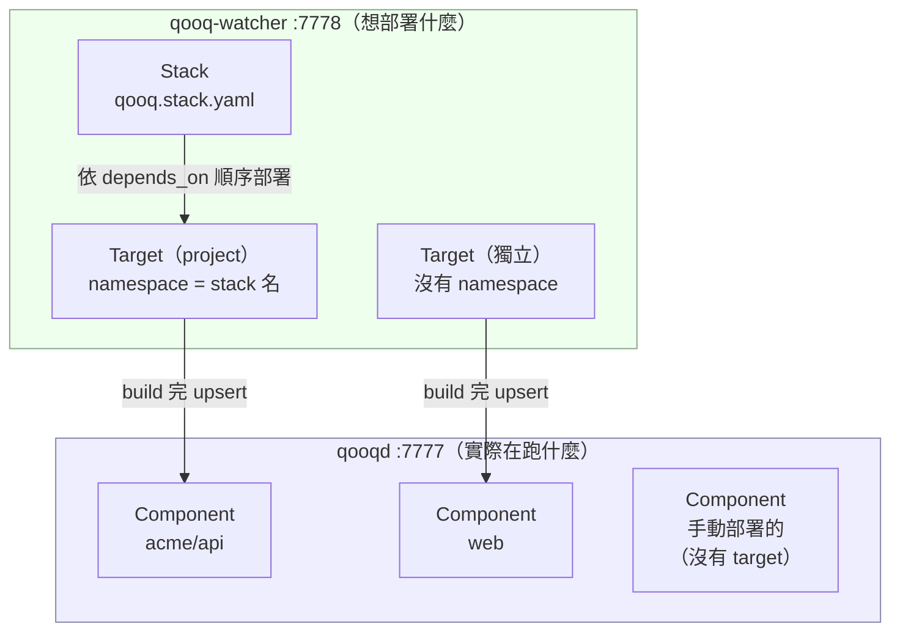

# qooq 使用說明

[English](USAGE.md) | 繁體中文

*執行檔操作手冊——給第一次拿到這個 repo 的人：怎麼建置、怎麼跑、怎麼從 git push 一路自動部署成 container。*

> 架構總覽請看 [ARCHITECTURE.md](ARCHITECTURE.zh-TW.md)；`qooq.yaml` 欄位參考見 [DEPLOY-CONFIG.md](DEPLOY-CONFIG.zh-TW.md)。這份文件只講操作。

## 目錄

- [三個執行檔](#三個執行檔)
- [東西之間的關係](#東西之間的關係)
- [安裝（不從原始碼）](#安裝不從原始碼)
  - [起停：qooq up / down / status](#起停qooq-up--down--status)
  - [確認整條鏈是活的：make smoke](#確認整條鏈是活的make-smoke)
- [建置（從原始碼）](#建置從原始碼)
  - [e2e 測試的兩條路](#e2e-測試的兩條路)
- [快速開始](#快速開始)
- [Process Runtime 模式](#process-runtime-模式)
- [Auth 與存取控制](#auth-與存取控制)
- [用 `qooq auth` 登入雲端](#用-qooq-auth-登入雲端)
- [不用 git：qooq deploy .](#不用-gitqooq-deploy-)
- [GitOps 自動部署](#gitops-自動部署)
  - [停止、暫停、移除](#停止暫停移除)
  - [`--repo` 參數格式](#--repo-參數格式)
  - [Webhook 觸發](#webhook-觸發)
  - [使用 @檔案 傳遞 Secret](#使用-檔案-傳遞-secret)
  - [App Manifest](#app-manifest)
  - [repo 沒有 qooq.yaml 的時候](#repo-沒有-qooqyaml-的時候)
  - [Image 部署模式](#image-部署模式)
  - [CI 直接部署](#ci-直接部署)
- [Stack：一次部署多個專案](#stack一次部署多個專案)
- [備份與還原](#備份與還原)
  - [更版與災難復原](#更版與災難復原)
- [常見問題](#常見問題)
- [相關文件](#相關文件)

## 三個執行檔

| 執行檔 | 角色 | 預設位址 |
|---|---|---|
| `qooqd` | orchestrator daemon：管 component（container 或原生程序）的部署、重啟、健康檢查 | `127.0.0.1:7777` |
| `qooq` | CLI：對 qooqd 與 qooq-watcher 下指令（**獨立 repo：[qooq-cli](https://github.com/qooqapp/qooq-cli)**） | — |
| `qooq-watcher` | GitOps service：盯著 git repo，有新 commit 就 build image → 部署到 qooqd | `127.0.0.1:7778` |

## 東西之間的關係

一台機器上跑兩個 daemon：**qooqd** 管容器，**qooq-watcher** 管「什麼時候該部署」。
兩邊各有自己的資料，關係是這樣：



看懂三件事就夠了：

1. **一個 target 對一個 component，而且只有一個**。兩張表都印 `NAMESPACE` + `COMPONENT`／
   `NAME` 這兩欄（順序、寫法都一樣），那組合就是兩張表唯一的接合處，直接對照即可。
   第二個 target 指向同一個 component 會被擋掉（409）。
2. **component 的完整名字是 `namespace/name`，每個 component 都有 namespace**。沒指定就是
   `default`——那是真的存起來的值，API 回的就是 `"namespace":"default"`。表格把兩半拆成兩欄，
   這樣「誰在哪個 stack 上」用眼睛掃一欄就好；要當參數用時把兩半接起來寫成 `acme/api` 即可
   （`watch get` 印的就是接好的形式）。`default/api` 跟 `api` 兩種寫法都能定址同一個東西。
3. **stack 的 namespace 就是 stack 自己的名字**。看到 `acme/api` 就是「stack `acme` 裡的
   project `api`」；看到沒有斜線的 `web` 就是獨立 target 或手動部署的。

怎麼**設定** namespace：

| 建立方式 | 參數 | 結果 |
|---|---|---|
| `qooq component deploy/upsert` | `--namespace acme` | component 叫 `acme/<name>` |
| `qooq watch add` | `--namespace acme` | 這個 target 部署出的 component 叫 `acme/<component>` |
| `qooq stack add --name acme` | 不用另外設 | 每個 project 自動落在 namespace `acme`、network `qooq-acme` |

不設就是 `default`；`default` 是保留字，stack 不能叫這個名字（會被 400 擋掉）。

`default` 有一個例外要知道：**它不會出現在容器名字與網址裡**。`default` 底下的 component 叫
`api` 的容器就叫 `api`（不是 `default_api`），網址還是 `api.localhost`（不是
`api.default.localhost`）。其他 namespace 才會加前綴（`acme` 底下的 `api` → 容器 `acme_api`、
網址 `api.acme.localhost`）。這樣既有部署不會因為填上預設值而被改名、斷路由。

另外，**component 名字現在一律要是小寫 DNS label**（`a-z`、`0-9`、`-`）。以前沒有 namespace
的舊 component 可以用 `my_app.v2` 這種名字，現在不行了——名字會變成網路上的 DNS alias，不合
規格的名字本來就沒辦法被同 network 的其他 component 叫到。既有的 component 不會因此壞掉，
但下次部署會被擋下來要求改名。

```bash
qooq stack ls              # 有哪些 stack
qooq stack get acme        # 這個 stack 的每個 project：狀態、depends_on、commit
qooq watch ls              # 有哪些 target，各自部署到哪個 component
qooq component ls          # 實際在跑什麼（NAMESPACE 欄看得出屬於哪個 stack）
```

> [!NOTE]
> 反過來查（「這個 component 是誰部署的」）目前只能從名字推：qooqd **不知道** watcher 的存在，
> 它只收到「部署這個 spec」的請求。這是刻意的分層——qooqd 沒有 watcher 也能單獨用。

`component ls` / `watch ls` 都吃 `--sort` 與 `-r`：

```bash
qooq component ls --sort started        # 跑最久的在前
qooq component ls --sort phase -r       # 用狀態分群，反向
qooq watch ls --sort last-build -r      # 最近才建置的在前
qooq watch ls --sort namespace          # 同一個 stack 的 target 排在一起
```

沒有 namespace 的一律排在最前面（`component ls` 的預設排序也是先 namespace 再 name）。

## 安裝（不從原始碼）

```bash
sh install.sh

# 裝到別的地方（不需要 sudo）
PREFIX=~/.local/bin sh install.sh

# 從私有 fork 安裝：要一個有讀取權的 GitHub token
GITHUB_TOKEN=ghp_... QOOQ_REPO=you/qooq QOOQ_CLI_REPO=you/qooq-cli sh install.sh

# archive 放在自己的網站／對象儲存時（不用 token）
QOOQ_DOWNLOAD_BASE=https://dl.example.com/qooq/v0.2.0 VERSION=v0.2.0 sh install.sh
```

裝完三個執行檔（`qooqd` / `qooq-watcher` / `qooq`）都在 PATH 上。

### 起停：`qooq up` / `down` / `status`

```bash
qooq up                # 起兩個 daemon，state 全部在 ~/.qooq（QOOQ_HOME 可換）
qooq up --ingress      # 順便開反向代理（會綁 :80）
qooq up --no-watcher   # 只要 qooqd
qooq status            # 現在跑著沒
qooq down              # 停掉兩個 daemon
```

幾件值得知道的：

- **state 一律在 `~/.qooq`**：`qooq.db`、`watcher.db`、log、pid 都在那。在專案目錄裡打
  `qooq up` **不會**在你的 repo 裡留下資料庫檔（這是直接跑 binary 時的老問題）。
- **idempotent**：已經在跑的不會被重起。
- **起不來會把 log 尾巴印出來**，不用自己去翻檔案。
- **`qooq down` 不會停掉你部署的 component**——那些是 docker 的容器，不是 daemon 的子程序。
  下次 `qooq up` 起來會自動接管它們（孤兒認領）。
- **port 被別人佔住時會講清楚**，而不是假裝「已經在跑了」。

> [!NOTE]
> `qooq up` 是**原生程序**的跑法；`qooq compose` 是同一件事但用容器跑，需要本 repo 的
> compose 檔。兩者都能用時選一個就好，不要同時起（會搶同一組 port）。

### 從 coding agent 用：`qooq-deploy` skill

不想記指令的話，qooq 附一個 skill——說「幫我部署這個專案」就會偵測型別、
寫 `qooq.yaml`、起 daemon、部署，最後**實際 curl 過**才把網址交給你。

**Claude Code、Codex、Cursor 三個都支援**，因為它們讀同一種格式（一個目錄，裡面
`SKILL.md` 帶 `name`/`description` frontmatter，加 `scripts/`）。所以 qooq 只維護一份
內容，`--agent` 只決定裝到哪：

| Agent | 指令 | 裝到 |
|---|---|---|
| Claude Code | `qooq skill install qooq-deploy` | `~/.claude/skills/` |
| Codex | `qooq skill install qooq-deploy --agent codex` | `~/.codex/skills/`（`CODEX_HOME` 會被尊重） |
| Cursor | `qooq skill install qooq-deploy --agent cursor` | `~/.cursor/skills/` |
| 兩者共用 | `qooq skill install qooq-deploy --agent agents` | `~/.agents/skills/`，Codex 與 Cursor 都會掃 |

`--dir` 可以直接指定目錄（例如要裝成專案內的 `.agents/skills/`，讓整個 team 跟著 repo 走），
它會蓋掉 `--agent`。`qooq skill ls` 列出目前裝給了哪些 agent。

**SKILL.md 裡的 script 路徑是安裝時 render 的**：文件必須給絕對路徑（agent 的工作目錄是
使用者的專案，相對路徑指不到 skill 自己），所以裝到哪裡，文件裡就寫哪裡。Claude Code 那條
是恆等變換，既有安裝逐位元不變。

Claude Code 另外可以走 plugin（這條**不需要**先有 qooq，skill 會用 repo 裡的 `install.sh`
自己裝一份）：

```
/plugin marketplace add qooqapp/qooq
/plugin install qooq-deploy@qooq
```

重開 session（Cursor 是 reload）生效。

> **已實測**：四個目標的安裝、路徑 render、script 在 Codex 位置且無 `CLAUDE_*` 變數下實跑。
> **未實測**：在真正的 Codex 或 Cursor 介面裡叫起這個 skill 並完成一次部署。

skill 找 CLI 的順序：`QOOQ_CLI` → PATH 上的 `qooq` → 原始碼 checkout → 裝一份。
所以開發這個專案的機器會用你 build 出來的 binary，別人的機器用他裝好的那份。

### 開機自動啟動：`qooq service`

`qooq up` 只活到你登出或關機為止。機器一重開，兩個 daemon 都不會回來——而**沒有人會通知你**，
只有下次發現某個 app 不見了才知道。要留著跑的機器裝成服務：

```bash
qooq down                    # 先停掉手動起的，不然會搶 port
qooq service install         # macOS 用 launchd、Linux 用 systemd --user
qooq service install --ingress   # 跟 qooq up 同一組 flag
qooq service status          # 裝了沒、活著沒
qooq service uninstall       # 移掉服務；資料與容器都不動
```

- **unit 是生出來的，不是抄的**：內容來自 `qooq up` 同一份 daemon 定義，所以 flag 改了不會
  有兩份說法。
- **`DOCKER_HOST` 會烘進去**：OrbStack／Colima／Rancher Desktop 把 socket 放在非標準路徑並
  記在 docker *context* 裡，而 daemon 讀的是 `DOCKER_HOST`。終端機裡 `qooq up` 每次都重新
  解析，開機時沒有人可以問——所以安裝當下解析一次寫死。**裝的時候讓 docker 是開著的**，
  否則會退回預設 socket 並印一行提醒。
- **會自己重啟**：docker 通常比 qooqd 晚幾秒才就緒，而 qooqd 連不到 docker 就會退出。
  launchd 的 `ThrottleInterval` 與 systemd 的 `RestartSec` 都設 10 秒，把這個競爭變成
  「晚一點起來」而不是「沒起來」。
- **Linux 伺服器要多一步**：user service 在你登出後會被收掉，除非
  `loginctl enable-linger $USER`。指令輸出會提醒。

### 確認整條鏈是活的：`make smoke`

```bash
make smoke      # 約 1 分鐘
```

會建一個真的 git repo、真的 push、讓 watcher 真的 build 並部署，然後**用 qooq 自己回報的
網址**去 curl，再 push 第二個 commit 驗證會自動重新部署。做完全部清乾淨，daemon 本來沒在跑
就關掉、本來在跑就留著。

跟 `make test` 測的東西不同：那是單元測試，這支跑的是真 docker、真 git、真 HTTP，
回答的是「這個 build 到底能不能用」。升級或改完環境之後跑它最有價值。

**想自己手動走一遍**（看得到中間狀態）：見 [WALKTHROUGH.md](WALKTHROUGH.zh-TW.md)。

## 建置（從原始碼）

```bash
make build   # 本 repo 只出兩個 daemon：bin/qooqd、bin/qooq-watcher

# CLI 在獨立 repo（部署 daemon 不用帶 CLI）；它以 replace 依賴本 repo，要並排 checkout：
git clone https://github.com/qooqapp/qooq-cli ../qooq-cli
make -C ../qooq-cli build   # -> ../qooq-cli/bin/qooq
```

> [!TIP]
> 開發時也可以直接 `go run ./cmd/qooqd ...`。以下範例的 `bin/qooq` 一律指
> qooq-cli repo build 出的執行檔——從本 repo 目錄跑就是 `../qooq-cli/bin/qooq`，
> 建個 symlink `ln -s ../qooq-cli/bin/qooq bin/qooq` 可讓範例照抄可用。

### e2e 測試的兩條路

**A. 原生 binary（開發迭代用，最快）**：`make build` 後照下方「快速開始」與
「GitOps 自動部署」的步驟跑（daemon、watcher、demo repo 三個終端）。改一行碼重測
只要重編一個 binary。

**B. docker compose（驗部署形態，2026-07-12 於 macOS/OrbStack 實測全鏈通過）**：

<details>
<summary>完整 docker compose e2e 腳本</summary>

```bash
# demo bare repo 需在這份原始碼旁邊的 ../qooq-demo.git：照 WALKTHROUGH 第三關建，
# 把 ~/qooq-demo 換成 ../qooq-demo。CLI 用 make build 的 bin/qooq
QOOQ_TOKEN=e2e QOOQ_WATCHER_SECRET_KEY=e2e QOOQ_WATCHER_HTTP_TOKEN= \
  docker compose -f docker-compose.yml -f docker-compose.e2e.yml up -d --build --wait
# --wait：等到兩個服務都 healthy 才返回，返回後即可直接下 CLI 指令
bin/qooq --token e2e system health          # 應回 status: ok
bin/qooq --token e2e --watcher-addr http://127.0.0.1:7778 \
  watch add --name demo --repo file:///repos/qooq-demo.git --component demo-web --poll 10
# 在 ../qooq-demo push 一個 commit（push 要到 bare repo），≤10s 後：
curl http://127.0.0.1:8080                  # 應回 demo 頁面
# 收攤（qooqd 部署的 component 是 compose 外的兄弟容器，要另外刪）：
QOOQ_TOKEN=e2e QOOQ_WATCHER_SECRET_KEY=e2e QOOQ_WATCHER_HTTP_TOKEN= \
  docker compose -f docker-compose.yml -f docker-compose.e2e.yml down -v
docker rm -f demo-web
```

</details>

> [!NOTE]
> compose 檔用 host network（qooqd 的 health probe 需要），Linux 原生支援；
> macOS 上 OrbStack 可直接跑（會把 VM 內的 port 轉發到 mac localhost），
> Docker Desktop 需 4.34+ 並啟用 host networking。

## 快速開始

容器化整組跑（qooqd + watcher 一起，最常用）用 CLI 的 compose 指令包 docker compose：

```bash
export QOOQ_COMPOSE_DIR=/path/to/qooq        # 含 docker-compose.yml 的目錄（設一次）
bin/qooq compose up        # 啟動整組並等 healthy（--build 先重建 image）
bin/qooq compose status    # 看狀態
bin/qooq compose stop      # 停（保留資料）；compose down -v 連資料一起刪（不可逆）
```

> 這個指令 2026-07-28 從 `qooq stack` 改名——`stack` 現在指「一組一起部署的專案」
> （見下方 [Stack](#stack一次部署多個專案)）。舊的 `QOOQ_STACK_DIR` 仍然讀得到。

（compose 需要的 `QOOQ_TOKEN`/`QOOQ_WATCHER_SECRET_KEY` 放該目錄的 `.env`，已被 .gitignore 排除。）

原生跑單一 daemon（docker runtime）：

```bash
# 1. 起 daemon（前景跑；-data 是 bbolt 檔路徑，預設 qooq.db）
bin/qooqd -listen 127.0.0.1:7777 -data qooq.db

# 2. 另開終端，確認活著
bin/qooq system health          # {"status":"ok","runtime":"docker"}

# 3. 部署一個 component（會自動 docker pull）
bin/qooq component deploy --name web --image nginx:alpine --port 8080:80

# 4. 常用操作
bin/qooq component ls                 # 列表（NAME / PHASE / UPTIME / IMAGE / PORTS / ID）
bin/qooq component get web           # 詳細（含 previous_image、restart_exhausted）
bin/qooq component get 01KZ2X2YBKTE  # id 前綴也能定址（ls 印的短 id 直接貼上就好）
bin/qooq component logs web -f       # 串流 log（Ctrl-C 結束）
bin/qooq component stats web -w      # 即時資源 dashboard（每 2s 更新）
bin/qooq component stop web
bin/qooq component start web
bin/qooq component rm web
```

換版與回滾：

```bash
bin/qooq component upsert --name web --image nginx:1.27-alpine --port 8080:80  # 換 image（保留 ULID）
bin/qooq component rollback web                                                  # 換回 previous_image
```

有用的 flags（`deploy`/`upsert` 同源）：
`--env K=V`（可重複）、`--restart no|on-failure|always`、`--cpu 0.5`、`--mem 64m`、
`--health-http /healthz --health-port 8080`（或 `--health-exec CMD`）。

## Process Runtime 模式

不用 docker，直接跑原生程序：

```bash
bin/qooqd -runtime process -listen 127.0.0.1:7777 -data qooq.db
# image = host 上的可執行檔路徑；--cmd 是參數
bin/qooq component deploy --name svc --image /usr/local/bin/myapp --cmd --port --cmd 9000
```

log 在 `<data 檔旁>/qooq-proc/<id>/stdout.log`。

> [!WARNING]
> v1 限制（已拍板）：無隔離（共享 fs/網路）、macOS 無 stats、資源限制只在 Linux
> 生效（cgroups v2，建議 root 執行）。

## Auth 與存取控制

```bash
bin/qooqd ... -token s3cret                # 或 QOOQ_TOKEN env
bin/qooq --token s3cret component ls       # CLI 帶 token（或 QOOQ_TOKEN env）
```

watcher 同理：`QOOQ_WATCHER_HTTP_TOKEN`（API auth）與 `QOOQ_WATCHER_SECRET_KEY`
（credential 落盤加密），CLI 端用 `--watcher-token`/`QOOQ_WATCHER_TOKEN`。

> [!IMPORTANT]
> 不設 token = 完全無驗證（只 bind localhost）。**`QOOQ_WATCHER_HTTP_TOKEN` 與
> `QOOQ_WATCHER_SECRET_KEY` 兩個至少設一個**，否則 `GET /v1/backup` 拿得到明文
> credential。

### 容器資源上限（operator 旗標）

```bash
bin/qooqd ... -container-pids-limit 2048 -container-memory-max 2g -container-cpus-max 2
# 或 QOOQ_CONTAINER_PIDS_LIMIT / QOOQ_CONTAINER_MEMORY_MAX / QOOQ_CONTAINER_CPUS_MAX
```

- `-container-pids-limit`：每個容器的 process+thread 上限，預設 **2048**（fork bomb 防護），`0`＝不限。
- `-container-memory-max`／`-container-cpus-max`：天花板，預設不設（線下版行為不變）。設了之後，沒寫
  限制的 component 拿到天花板，寫得比天花板大的被夾到天花板（log warn），比天花板小的照用。
- 壞值讓 qooqd 直接 exit 1。實際生效值看 `docker inspect`；`component get` 顯示的是請求值。

## 用 `qooq auth` 登入雲端

**只有用 qooq Cloud 時才需要。** 自己機器上跑 qooq（`qooq up`）沒有帳號這回事，
不必登入。

```bash
qooq auth login                  # 開瀏覽器，點你平常用的登入方式
qooq auth status                 # 現在是誰、哪個帳號
qooq auth logout                 # 只忘掉本機這份，不等於撤銷
```

token 存在 `~/.qooq/auth.json`（權限 0600）。

幾件值得知道的事：

- 發出來的 token 會出現在 qooq Cloud 網頁的「API token」頁面，名字是 `CLI on <機器名>`，
  **撤銷在那裡做**。`qooq auth logout` 只是把本機那份刪掉。
- **沒有瀏覽器的機器**（SSH、容器）用
  `qooq auth login --with-token --account <slug>`，從 qooq Cloud 網頁產一個貼進去。

### 用 CLI 管理 qooq Cloud 上的服務（`qooq project`）

登入之後，不開網頁也能建立、部署、查看服務。輸出給人看是表格，給腳本／AI agent 用 `-o json`
（原樣的 project 物件，進度訊息一律走 stderr，stdout 保持可解析）。

```bash
qooq project ls [-n NS]                                   # NAMESPACE NAME STATUS PHASE URL COMMIT
qooq project create web --repo https://github.com/me/web [--branch main] [-n default] [--wait]
qooq project create web --image nginx:alpine [--port 80] [--registry-auth user:pass] [--wait]
qooq project get web [-n NS]                              # 全部欄位：網址、最後錯誤、services、references
qooq project deploy web [-n NS] [--wait] [--timeout 15m]
qooq project logs web [-n NS] [--tail N] [-f]             # app 執行時印的東西（-f 持續追蹤）
qooq project logs web [-n NS] --build                     # 最近一次 build log
qooq project rm web [-n NS] --yes                         # 會連執行中的服務一起刪，沒有 --yes 一律拒絕
```

共用旗標：`--addr`（qooq Cloud 位址）、`--account`（預設用登入時的帳號）、`-o table|json`。
沒指定 `-n` 時，名字只在一個 namespace 出現就直接用，多個就報錯並列出來。

`--wait` 每約 3 秒輪詢，**只接受「觸發之後才開始並結束」的 build**，不會把上一次的 success 當成這次的結果。成功印網址（沒有就印
`no public URL`）；失敗印 build 錯誤與 build log 最後 30 行（建好了但程式起不來時改印 app 自己的輸出——建置輸出只會顯示成功）並以非 0 結束；
`needs_input`（manifest 要的值還沒填）也是非 0，訊息會說明要去補值：
`qooq project input web` 列出 qooq.yaml 宣告的 inputs 與哪些已填，
`qooq project input web API_KEY=@key.txt` 填值（`@檔案` 讓密鑰不進 shell history；`KEY=` 清掉），
填完會自動重新部署。未登入或 token 失效時會提示
`qooq auth login`。

`qooq project stop|start web` 停止／開始服務本身（專案與設定都留著）；`qooq project pause|resume web`
暫停／恢復自動部署（跑著的不受影響）。**兩組是分開的**：只 stop 不 pause 的話，下一次 push 會把它
部署回來——指令執行後會印這句提醒。

## 不用 git：`qooq deploy .`

在專案資料夾執行，就會打包、上傳到這台機器的 qooq、建置、部署，最後印出網址。第一次會建立服務，
之後每次執行都是更新。改完程式要更新，就再跑一次。

```bash
qooq up                   # 還沒啟動的話
cd my-app
qooq deploy .             # 服務名稱：qooq.yaml 的 app，沒有就用資料夾名稱（或 --name）
```

- 打包的內容：git repo 裡照 `.gitignore`；不是 git repo 就排除 `.git`、`node_modules`、`.venv`
  等；`.qooqignore`（同 gitignore 語法）再排除更多。**`.env*` 一律不上傳**，需要的值請在
  `qooq.yaml` 宣告成 `inputs:`，再用 `qooq watch set-input <name> NAME=VALUE` 給值。
- 內容跟正在跑的一樣時什麼都不做；`--force` 強制重建。
- 建置輸出：`qooq watch build-log <name>`；app 的輸出：`qooq watch logs <name> [-f]`。
- 已經用 git（`qooq watch add`）部署的同名服務不能拿來上傳，會直接拒絕並說明。
- 上傳到 qooq Cloud 要加 `--cloud`（見「用 `qooq auth` 登入雲端」）；`--addr` 指定 qooq Cloud 位址，`--account` 選帳號。

## GitOps 自動部署

從 git push 到 image 再到 container 的完整流程。用 `examples/static-web` 做一個給它盯的示範 repo，
見 [WALKTHROUGH 第三關](WALKTHROUGH.zh-TW.md#第三關gitops-全鏈核心)。

```bash
# 1. 起 qooqd（docker runtime）+ watcher（另一個終端；在乾淨目錄跑，sqlite/artifacts 會建在 cwd）
bin/qooqd -listen 127.0.0.1:7777 -data qooq.db
cd /tmp/qooq-watcher-home && /path/to/qooq/bin/qooq-watcher

# 2. 註冊一個 watch target（--repo 格式見下方說明）
bin/qooq watch add --name demo \
  --repo file://$HOME/qooq-demo.git \
  --branch main --component demo-web \
  --deploy-spec '{"ports":["8080:80"]}' --poll 10

# 3. push 一個 commit → 最多 10s 內 watcher 會 clone → docker build → 部署
bin/qooq watch ls        # LAST_COMMIT / STATUS / LAST_BUILD 欄看進度（ok / building / failed）
                         # COMPONENT 欄與 `component ls` 的 NAME 欄寫法相同，用來對照兩張表
bin/qooq watch get demo  # 失敗時看 last_build_error
bin/qooq component ls    # 部署結果（image tag = demo-web:<短sha7>）
```

`--component` 是這個 target 的所有物：**一個 component 只能有一個 target**，再指一個過去會被
拒絕（409）。兩個 target 指同一個 component 不是共用，是輪流覆蓋——各自 build 完都部署到同一個
component，誰後跑誰贏，而兩邊的 status 都寫著 success。要換 repo 就 `watch rm` 舊的再 `watch add`。

repo 根目錄可放 `qooq.yaml`（app manifest）宣告 build/run/health/requests/limits，
operator 的 `--deploy-spec` 會逐欄位覆蓋它（欄位參考見 [DEPLOY-CONFIG.md](DEPLOY-CONFIG.zh-TW.md)）。

### 停止、暫停、移除

一個 target 有五個「不是重新建置」的動詞，分屬**刻意分開的三件事**（行程：stop／start；輪詢：pause／resume；移除：rm）——
混用會得到你沒有要的結果：

| 指令 | 動到什麼 | 沒動到什麼 |
|---|---|---|
| `qooq watch stop <name>` | **行程**。容器停掉，位址立刻打不開 | target、設定、image、volume 全留著 |
| `qooq watch start <name>` | 用**最後一次建置成功的 image** 重新啟動 | 不重新建置（要重建用 `trigger`） |
| `qooq watch pause <name>` | **輪詢**。remote 有新 commit 也不建 | 正在跑的照常服務 |
| `qooq watch resume <name>` | 放回 sweep，**並立刻檢查一次** | — |
| `qooq watch rm <name>` | target **與它部署的 component**（容器會被刪，位址失效）、它的資料（volume、services 的資料庫），以及 qooq 為它建的 image | — |

```bash
bin/qooq watch stop demo      # stopped demo
bin/qooq watch pause demo     # paused automatic deploys for demo
bin/qooq watch resume demo    # resumed automatic deploys for demo; checking now
bin/qooq watch start demo     # started demo
```

**停止不等於暫停。** 一個被 stop 但仍在被 watch 的 target，**下一次 push 會把它部署回來並啟動**
——部署這個動作本身就會啟動它所部署的東西。要讓它停著不動，`stop` 之後一併 `pause`。

**暫停不等於拒絕部署。** `pause` 擋的只有自動那條路；`qooq watch trigger --force <name>`
仍然會建。少了這一條，暫停中的 target 按「部署」會**靜默沒反應**，而那正是最可能有人在修的
那個 target。

**`pause` 跟 watcher 自己的放棄是兩回事。** 連續失敗 10 次之後 watcher 會自己停掉重建，
理由寫在 `paused_reason`——那是故障，不是決定；前者 `watch resume` 解除，後者是修好 repo 再
`watch trigger`。兩個狀態在 `watch ls` 的 STATUS 欄都看得見，而且分得出來：

```
STATUS
success (paused)     ← 有人把自動部署關掉了
failed (gave up)     ← watcher 連續失敗太多次，自己停了
```

**一定要在 `ls` 這層看得見**，道理跟 `component ls` 印 `Running (stale addr)` 一樣：
這種狀況的難處正是**其他每個訊號都說正常**——上一次建置就是成功的，而且會一直是成功的，
只是從此沒有新的了。`watch get` 另外印完整的 `deploy_paused` 與 `paused_reason` 兩個欄位。

**對沒有部署過的 target 下 `stop`／`start` 會回 409**（target 在，但沒有東西可以停），
不是 404——404 會讀起來像「沒有這個 target」。

#### `watch rm` 會連服務一起刪

```bash
bin/qooq watch rm demo
# removed target demo and its deployment

bin/qooq watch rm demo --keep-component
# removed target demo; its deployment was left in place
```

**`--keep-component` 是給「把這個部署交給別人管」用的**（搬進 stack、換一台 watcher），
不是給「我只是想清掉清單」用的。沒有這個旗標時，舊版的行為是只刪 target：容器繼續跑、位址繼續
通，而專案從每一張清單上消失——**沒有人要的那個部署，同時也是沒有人找得到的那個**。

移除的順序是**先拆 component 再刪 target row**：qooqd 連不上時 row 會留著，所以你還看得到它、
還可以重試；反過來做就是製造孤兒。

### 部署需要「只有你知道的值」時

manifest 可以用 `inputs:` 宣告 repo 不可能知道的值（API 金鑰、對外網址、網域）。
缺值時 target 停在 `needs_input` 而**不跑任何 build**，並告訴你缺什麼：

```bash
bin/qooq watch get demo
# missing inputs (deploy is blocked until these are supplied):
#   STRIPE_KEY — Stripe 密鑰，從 dashboard → Developers → API keys 取得 (e.g. sk_live_xxx)
#   supply with: qooq watch set-input demo STRIPE_KEY=<value>

bin/qooq watch set-input demo STRIPE_KEY=@/path/to/key.txt   # @檔案：不進 shell history
# 補上就自動重新部署，不用等輪詢也不用推 commit
```

建 target 時就知道的值可以直接帶：`watch add ... --input PUBLIC_HOST=192.168.1.50`。
manifest 那一側的寫法見 [DEPLOY-CONFIG.md 的 Inputs 一節](DEPLOY-CONFIG.zh-TW.md#inputs)。

### 用網址取代 port：`-ingress`

> 用 `qooq up` 啟動時**預設已開啟**（port 80），不需要自己帶 `-ingress`。改 port 或關掉：
> `qooq config set ingress.port <n>`（0 = 關）；只讓本機連得到：`qooq config set access local`
> （qooqd 端是 `-publish-ip 127.0.0.1 -ingress-bind-ip 127.0.0.1`，此時不回報給區網用的 nip.io 網址）。
> 下面是直接跑 qooqd 時的旗標說明。

```bash
bin/qooqd -listen 127.0.0.1:7777 -data qooq.db -ingress
```

qooqd 會用 Caddy 當反向代理擋在所有 component 前面，每個 component 自動有兩個網址：

| 網址 | 誰用得到 |
|---|---|
| `http://web.localhost` | 這台機器的瀏覽器（**零設定**，不用改 hosts、不用 DNS） |
| `http://web.192.168.1.50.nip.io` | 同網段的手機、同事的電腦（靠公用 DNS 解析，也不用設定） |
| manifest 寫的 `domain:` | 你自己的正式網域（會排在最前面） |

namespace 不為空時是 `web.<namespace>.localhost`（hostname 不能有底線，所以不是容器名那個
`<ns>_<name>`）。`component get` 的 `endpoints` 會直接列出這些網址。

**預設關閉**，因為它會綁 :80——升級 daemon 不該無聲佔掉你的 80 port。其他旗標：
`-ingress-http-port`（預設 80）、`-ingress-tls`（見下）。

幾件實際會遇到的事：

- **路由到哪個 port**：component 的第一個 port。多 port 要指定是未來 `ingress:` 區塊的事。
- **開 ingress 之前就在跑的容器**：不用重新部署，sweep 會自動把它接上 ingress 網路。
- **沒有註冊的 hostname**：Caddy 回空的 200（不是 404），代表「沒有這條路由」。
- **process runtime 不支援**：`-runtime process -ingress` 會在啟動時直接報錯退出。

### 路由要更細：manifest 的 `ingress:`

多個網域、指定要對外的是哪個 port、把 `/api` 轉給另一個 app——寫在 app 自己的
`qooq.yaml` 裡，欄位表見 [DEPLOY-CONFIG.md 的 Ingress 一節](DEPLOY-CONFIG.zh-TW.md#ingress)：

```yaml
# 前端
ingress: {hosts: [app.example.com]}
# 後端（同一個網域，只吃 /api，轉發前拿掉前綴）
ingress: {hosts: [app.example.com], path: /api, strip_path: true, port: 8080}
```

有 `path` 的會自動排在沒有的前面，所以「全站給前端、`/api` 給後端」不用管順序。

### TLS

兩種簽發方式，用 `-ingress-tls-issuer` 選：

| | `acme`（預設） | `internal` |
|---|---|---|
| 誰簽 | Let's Encrypt | Caddy 內建 CA |
| 需要 | 網域 A record 指到這台 + 443 對外通 | 什麼都不用 |
| 簽哪些 hostname | **只簽公用 CA 簽得出來的**（`.localhost`/`.nip.io`/裸 IP 一律跳過維持 HTTP） | **全部**，含 `.localhost` |
| 代價 | — | 每台要連的裝置都要信任那個 root 憑證 |

```bash
# 本地想要 https（service worker、clipboard API 那些需要 secure context 的東西）
bin/qooqd ... -ingress -ingress-tls -ingress-tls-issuer internal
```

`internal` 模式**不會**把 http 轉到 https，兩個並存——本地開發常常兩個都在用，
自動轉址會讓原本好好的 http 連線突然壞掉。

`acme` 跳過非公網域是刻意的：對解析不到的網域反覆挑戰會燒掉 Let's Encrypt 的 rate limit，
而那個額度跟真的簽得出來的網域共用——一個設錯的 component 會拖垮全部。

> [!NOTE]
> `internal` 這條鏈實測過（443 監聽、憑證簽發、https 路由、http 並存）。
> **`acme` 跟 Let's Encrypt 的實際交換仍未實測**——需要公網網域與對外 443。

### 部署完的位址

`component get` 的 `endpoints` 是 **qooqd 自己算出來的**可用網址（不是寫死的 localhost）：

```bash
bin/qooq component get demo-web | grep endpoints
# endpoints:         http://192.168.1.50:8080     ← 同網段的手機也連得到
```

位址來自 qooqd 的 advertise host：`-advertise-host`／`QOOQ_ADVERTISE_HOST` 沒設時偵測主要
網卡（開機 log 會印它選了哪個）。manifest 裡也可以用 `${host}` 引用同一個值，
把「給瀏覽器用的 base URL」寫成 `http://${host}:8080`，不必把區網 IP 寫死進 repo。

### `--repo` 參數格式

原則一句話：**填「watcher 程序看得到」的 URL**。三種形式：

| 形式 | 範例 | 搭配 |
|---|---|---|
| 本機 bare repo | `file:///Users/you/Projects/demo.git` | 無 auth（`.git` 後綴可省，git 會自動補） |
| HTTPS | `https://github.com/you/private.git` | `--auth-token @~/.qooq/token` |
| SSH | `git@github.com:you/private.git` | `--auth-ssh-key ~/.ssh/id_ed25519`（host key 見「常見問題」） |

> [!WARNING]
> 兩個常見坑：
> - **watcher 跑在 container 裡時，host 路徑在容器內不存在**。compose e2e 要用
>   `file:///repos/qooq-demo.git`（`docker-compose.e2e.yml` 把 `../qooq-demo.git`
>   掛在那裡），填 `/Users/...` 一定失敗。
> - **`file://` 要指向 bare repo，而且 push 要真的到它**。watcher 輪詢的是 bare repo
>   的 HEAD；在工作目錄 commit 而沒 push（或 origin 指錯地方），watcher 永遠看不到
>   新 commit。檢查法：`git -C <bare>.git log --oneline -1` 應等於你剛 push 的 commit。

### Webhook 觸發

push 觸發、免等輪詢。webhook 是「poke」：只驗簽、把該 target 排進下一輪檢查（≤10s），
**不解析 payload**。target 建立時要給 `--webhook-secret`（沒有 update API，要改 secret
就 `watch rm` 重加）：

```bash
bin/qooq watch add --name demo ... --webhook-secret @~/.qooq/hook-secret
```

端點 `POST /v1/webhook/<target-name>`，依 header 自動判斷驗簽方式：

```bash
# GitLab 式：共享 token（curl 測試最方便）
curl -X POST -H 'X-Gitlab-Token: <secret>' http://127.0.0.1:7778/v1/webhook/demo
# → 202 已排程；token 錯/沒帶 → 401；target 沒設 secret → 403；target 不存在 → 404

# GitHub 式：HMAC-SHA256(secret, raw body)
BODY='{"ref":"refs/heads/main"}'
SIG=$(printf '%s' "$BODY" | openssl dgst -sha256 -hmac '<secret>' | awk '{print $2}')
curl -X POST -H "X-Hub-Signature-256: sha256=$SIG" \
  -H 'Content-Type: application/json' --data "$BODY" \
  http://127.0.0.1:7778/v1/webhook/demo
```

真實 forge 設定：GitHub → repo Settings → Webhooks（自動用 `X-Hub-Signature-256`）；
GitLab → Settings → Webhooks 的 Secret token 欄（`X-Gitlab-Token`）。URL 都填
`http://<watcher位址>:7778/v1/webhook/<name>`（此端點免 bearer token，驗簽即是 auth）。

### 使用 @檔案 傳遞 Secret

`--auth-token`、`--webhook-secret`、`--deploy-spec` 的值以 `@` 開頭時視為檔案路徑，
讀檔內容（去頭尾空白）當值——token 不會留在 shell history 或 `ps` 輸出裡：

```bash
bin/qooq watch add --name private --repo https://github.com/you/private.git \
  --component private-web \
  --auth-token @~/.qooq/github-token --webhook-secret @~/.qooq/hook-secret \
  --deploy-spec @deploy.json
```

### App Manifest

repo 根目錄放 `qooq.yaml` 讓 app 自帶部署需求（ports/env/health/資源需求/domain/
設定檔/資料/相依服務）。欄位完整參考見 [DEPLOY-CONFIG.md](DEPLOY-CONFIG.zh-TW.md)，
十三個可跑範例見 [examples/](../examples/)
（`static-web/` 是唯一手寫 Dockerfile 的對照組，其餘都用 `build.template` 不放 Dockerfile）。
`examples/todo-stack/` 是兩個專案（api + web）用一份 stack manifest 一起部署的範例。

`build.template: <name>` 可指定內建 Dockerfile 模板（`go`/`node`/`python`/
`go-react`/`static-nginx`），repo 可完全不放 Dockerfile——細節見
[DEPLOY-CONFIG.md 的「內建 Dockerfile 模板」一節](DEPLOY-CONFIG.zh-TW.md#內建-dockerfile-模板)。

### repo 沒有 `qooq.yaml` 的時候

不會失敗。watcher 會**看檔案長相生成一份**，存起來給你改——這是為了「你不擁有、
也沒辦法往裡面加檔案的 repo」而做的。

```bash
qooq watch add --name blog --repo https://github.com/someone/blog --component blog
qooq watch manifest blog                  # 看它生成了什麼、以及為什麼
qooq watch manifest blog > blog.yaml      # 覺得猜錯了
vim blog.yaml
qooq watch manifest blog --file blog.yaml # 改回去，並立刻重建
```

判斷依據只有**檔案本身**：有沒有 Dockerfile（四個常見位置都找）、`package.json` 宣告了什麼、
Dockerfile `EXPOSE` 了哪個 port。它**不讀原始碼推行為**——那是 `qooq-deploy` skill
（有 LLM 讀進入點）的工作。

兩件值得知道的事：

- **每個判斷都附理由**，所以生成的內容看起來奇怪時，看得出它是根據什麼決定的。
- **改過就不會被蓋掉**：生成只在「存的那份是空的」時候跑。所以修正是一次性的，
  之後每次 push 都用你改好的版本。repo 後來自己加了 `qooq.yaml`，那份就直接贏。

### 帶設定檔與資料目錄的服務

大部分服務啟動時要讀一份設定檔、執行時要寫資料。兩件事各一行：

```yaml
run:
  files:
    - "./config.toml:/app/config.toml"   # 設定：唯讀、跟著 commit 版本化
  volumes:
    - "appdata:/app/data"                # 資料：讀寫、重新部署不會清掉
```

- 設定檔在 repo 裡跟程式碼一起進版控。改了再 push 就重新部署，**不用重 build image**。
- `appdata` 這種無斜線的純名稱是 watcher 管理的具名 volume；也可以直接寫 host 絕對路徑
  （`/srv/myapp/data:/app/data`）。
- 設定檔會**按 commit 版本化**，還在跑的舊容器不會突然讀到新內容；具名 volume **永不清除**。
- secret 不要進 repo：用 `run.env_file` 指向 host 上的檔案，或用 `${env.NAME}` 引用
  watcher 進程的環境變數。

可跑範例：[examples/config-file-app/](../examples/config-file-app/)。

### App + 資料庫

不用自己另外部署一台資料庫。`services:` 一行就有完整預設（image/port/資料 volume/
bootstrap 環境變數/健康檢查）：

```yaml
services:
  db:
    type: postgres        # postgres | mysql | mariadb | redis | mongo | custom
```

app 自動拿到 `DB_HOST`/`DB_PORT`/`DB_USER`/`DB_PASSWORD`/`DB_DATABASE`/`DATABASE_URL`；
框架要別的變數名就用 `${service.db.host}` 之類自己指。qooq 會**先把服務起好、確認 ready，
才部署 app**，密碼生成一次就固定，改 app 的程式碼重新部署也不會重啟資料庫。

展開後的 `<app>-db` 是**普通 component**：`qooq component ls/logs/stop/rollback` 都適用。

可跑範例：[examples/app-with-postgres/](../examples/app-with-postgres/)。

### 多個專案互相連得到

分開部署的前後端，兩份 `qooq.yaml` 都寫同一個 `network:`，就能用 component 名稱互打：

```yaml
network: todo
```

| 誰發出請求 | 用什麼位址 |
|---|---|
| 另一個容器（SSR server-side fetch、後端呼後端） | `http://<對方component名>:<容器port>` |
| 使用者的瀏覽器 | `http://<區網IP>:<host port>` |

**容器裡的 `127.0.0.1` 是容器自己**。沒寫 `network:` 的 app 會拿到專屬網路
`qooq-<component>`，只跟自己宣告的 services 同網。

### Image 部署模式

M20a：image 已經 build 好，watcher 只管部署。target 預設是 `source` 模式
（clone + build）。`--deploy-mode image` 改成監控 registry 上某個 tag 的
**digest** 變化——CI 或你手動 push 了同名 tag 的新版，watcher 下一輪
（≤poll 秒）就 pull + 部署，完全不 clone、不 build：

```bash
bin/qooq watch add --name webprod --deploy-mode image \
  --image-ref ghcr.io/you/web:latest --component web --poll 60
```

private registry 帳密放 `--auth-token`，格式 `username:password`（同樣支援 `@檔案`，
落地時走既有 AES-GCM 加密）。image 模式不吃 `--repo`/`--branch`/`--dockerfile`/
`--context-subdir`/`--manifest`（給了會 400）。

### CI 直接部署

M20b：`watch deploy`。不想等輪詢、或 tag 每次都不同（如 `web:sha-abc123`）時，
CI 在 build+push 完直接打：

```bash
bin/qooq --watcher-token $TOKEN watch deploy webprod --image ghcr.io/you/web:sha-abc123
# 或裸 API（CI 裡不用裝 CLI）：
curl -X POST -H "Authorization: Bearer $TOKEN" -H "Content-Type: application/json" \
  -d '{"image":"ghcr.io/you/web:sha-abc123"}' \
  http://<watcher>:7778/v1/targets/webprod/deploy
```

同步回傳部署結果（成功 200 / 失敗 502+原因）。對 image 模式 target，部署的 image
會成為之後輪詢的新基準（`image_ref` 一併更新）；對 source 模式 target 則不動它的
git 狀態（`last_commit` 不變）。

## Stack：一次部署多個專案

前一節的做法是：每個專案各建一個 target，每份 `qooq.yaml` 各抄一次同樣的 `network:`，
誰先誰後靠運氣。專案一多，「它們之間的關係」就無處可寫。

**stack manifest**（`qooq.stack.yaml`）就是寫這件事的地方。放在一個 repo 裡，描述哪些
專案組成一個 stack、誰要等誰：

（這套東西當初是照「煮一道菜」的比喻設計的——stack = 一道菜、project = 一道工序、
`services:` = 買現成的罐頭高湯。術語沒有沿用比喻，但對照著看最快。）

```yaml
version: 1
stack: acme-prod                # 決定 namespace、網路（qooq-acme-prod）與容器名前綴
description: Acme 的正式站

projects:
  api:
    path: ./services/api        # 來源 A：本 repo 的子目錄（吃該目錄的 qooq.yaml）
  web:
    repo: https://github.com/acme/web.git   # 來源 B：外部 repo
    branch: main
    depends_on:
      - api                     # 等 api 起來（Running）才部署
    env:
      API_BASE: "http://${project.api.host}:8080"  # stack 層注入，蓋過該 project 自己的 run.env

policy:
  max_failures: 10              # 同一 project 連續失敗這麼多次 → 整個 stack 暫停
```

```bash
bin/qooq stack add --name acme-prod --repo https://github.com/acme/prod.git
bin/qooq stack ls
bin/qooq stack get acme-prod         # 每個 project 的狀態、等誰、失敗次數
```

> [!IMPORTANT]
> **`projects:` 是 map，不是有序清單。** 寫的順序不影響任何事，順序完全由 `depends_on:`
> 決定。沒寫 `depends_on:` 的 project 一開始就平行處理。

> [!WARNING]
> **已經單獨部署過的專案，要先把舊 target 拆掉再放進 stack。** stack 擁有它的 namespace，
> 所以 `default/api` 進了 stack 之後叫 `acme-prod/api`——那是**另一個 component**，
> 位址也會變。舊 target 留著的話，同一個 repo 會有兩個 target 各自 build、各自部署，
> 而且兩邊的 status 都是 success。
>
> ```bash
> bin/qooq watch rm api            # 舊的 standalone target
> bin/qooq component rm default/api
> bin/qooq stack add --name acme-prod --repo ...
> ```
>
> 沒拆就建 stack 會被擋下來，`stack get` 的 `last_error` 會指名是哪個 target 佔著。
> **`--allow-duplicate` 不是用來繞過這個的**——那個旗標是給「刻意把同一個 app 跑兩套」
> （staging 一套、production 一套）用的，拿它來搬家會做出這道檢查本來要防的東西。

### 每個 project 怎麼做，寫在它自己的 `qooq.yaml` 裡

stack manifest 只寫「誰跟誰、誰先誰後」。build、services、files、volumes 全是 project
自己的事，所以同一個 repo 可以放進好幾個 stack 而不用改任何一行。

| 用途 | 名字 | 例 |
|---|---|---|
| 容器名、`component ls` | `<stack>_<project>` | `acme-prod_api` |
| **同網路內的位址（manifest 寫這個）** | `<step>` | `http://api:8080` |

一個 stack 一張網路，所以 manifest 永遠寫短名。`acme-prod` 與 `acme-staging` 兩個 stack
可以來自同一份 manifest，兩邊的 manifest 都寫 `http://api:8080`，互不相干。

外部 repo 沒有 `qooq.yaml` 也沒關係——qooq 會生一份，猜錯可以改
（`qooq watch manifest <stack>_<project>`，見 [DEPLOY-CONFIG.md](DEPLOY-CONFIG.zh-TW.md)）。

### `depends_on`：兩種等待

| 值 | 意思 | 用在哪 |
|---|---|---|
| `ready`（**預設**，寫成 `- api`） | 等到對方 Running | 下游一啟動就要連上游（絕大多數情況） |
| `started` | 只等對方的部署動作完成 | 上游啟動很慢，而下游本來就會自己重試 |

```yaml
depends_on:
  - api                         # ready
  - name: cache
    wait: started
```

代價要知道：`ready` 會讓一個啟動慢的 project 卡住整條下游鏈。六個 project 串成一條線、
每個暖機一分鐘，一次部署就是六分鐘。`started` 是給這種情況的逃生口。

### 有 project 壞掉的時候

qooq 是**收斂式**部署，不是交易式的：

1. 壞掉的 project **維持現在跑著的版本**，下一輪自動重試（`last_commit` 不動）。
2. 等它的下游**跳過**（skip）——**跳過不是拆掉**，它現在跑著的版本繼續跑。
3. 無關的分支照常部署，所以整個 stack 是 `degraded`：**一部分新版、一部分舊版**。
4. 同一 project 連續失敗 `policy.max_failures` 次（預設 10）→ 整個 stack `paused`：
   **正在跑的容器全部繼續跑**，但不再部署任何 project，凍結版本落差。

```bash
bin/qooq stack get acme-prod    # paused 時會告訴你是哪個 project、失敗幾次
# 修好之後
bin/qooq stack resume acme-prod
```

暫停的是**部署**，不是服務。這也是為什麼要暫停整個 stack 而不只是壞掉的那一個：
壞掉的那個本來就停在舊版了，真正的問題是其他 project 繼續往前造成的落差。

> **收斂式部署必然有短暫的「新版 a + 舊版 b」並存**（compose 也一樣）。
> 兩個 project 之間有不相容的 API 變更時會踩到——這是性質，不是 bug。

### 移除

```bash
bin/qooq stack rm acme-prod          # 容器繼續跑，只是不再自動部署
bin/qooq stack rm acme-prod --prune  # 連 component 一起收掉
```

從 manifest 裡拿掉一個 project **不會**自動刪掉它，只會在 `stack get` 標成 `(orphaned)`——
會自動刪掉的東西總有一天會刪到資料。services 與 volume 即使 `--prune` 也不動。

### 已知限制

- **外部 `repo:` project 一律無認證 clone**。stack 的 token 只用於它自己的 repo
  （與 `path:` project）——把它送去 manifest 指定的任意 host 等於把憑證交給第三方。
- **`${project.x.host}` 只有 `.host`**。project 的 port 寫在它自己的 `qooq.yaml` 裡，
  合成層沒有 clone 那個 repo 也不去讀它。`.port`/`.url` 會明確報錯並列出可用的 key。
- **namespace 目前是組織用的欄位，不是隔離邊界**。`${env.*}` 讀的仍是 watcher 進程的
  環境變數，多人共用一台 watcher 時是破口。

## 備份與還原

手動備份：

```bash
bin/qooq system backup qooq-backup.db   # qooqd 的 bbolt（活著也能備，一致快照）
bin/qooq watch backup watcher-backup.db # watcher 的 sqlite（含 credential，注意保護）
# 還原：停掉 daemon，把備份檔覆蓋回 -data / sqlite 路徑，再啟動
```

<details>
<summary>自動排程備份（flags / env 完整列表）</summary>

自動排程備份（不設 = 完全無自動備份，維持舊行為）。每隔 interval 快照一次到 dir，
只保留最新 keep 份（檔名帶時間戳 `qooq-YYYYMMDD-HHMMSS.db` / `watcher-...`，超出份數
的舊檔自動刪；備份失敗只 log 不會拖垮 daemon）：

```bash
# qooqd（flags 或對應 QOOQ_BACKUP_* env；interval 預設 1h、keep 預設 5）
bin/qooqd -backup-dir /var/backups/qooq -backup-interval 1h -backup-keep 5
#   等價 env：QOOQ_BACKUP_DIR / QOOQ_BACKUP_INTERVAL / QOOQ_BACKUP_KEEP

# watcher（viper config，env 前綴 QOOQ_WATCHER_；interval 預設 1h、keep 預設 5）
QOOQ_WATCHER_BACKUP_DIR=/var/backups/watcher \
QOOQ_WATCHER_BACKUP_INTERVAL=1h QOOQ_WATCHER_BACKUP_KEEP=5 bin/qooq-watcher
```

</details>

### 更版與災難復原

**日常更版**：`docker compose up --build`（或 `stack up --build`）不動 volume，qooqd 的
bbolt 資料庫原樣保留，新 image 起來後自動接管既有 component——不需要做任何額外動作。

> [!CAUTION]
> **誤按 `docker compose down -v`（volume 被清掉）**：bbolt 資料庫沒了，但 qooqd 部署的
> 兄弟容器（如果沒有一併被 down 掉）還活著。用同一個 `-instance`（或都不設）重新啟動一個
> 新 daemon，它開機時會自動「認領」這些容器：原本 Running 的視為 `DesiredRunning`（會繼續
> 被監控/健康檢查/crash 自動重啟）；原本被手動停掉的視為 `DesiredStopped`（不會被復活）。
> ULID 與名字都保留，`qooq component ls`/`get` 看起來就像資料庫沒丟過一樣。認領動作會記
> 一筆 `adopted_orphan` 事件（`qooq component logs`／events API 看得到）。**前提**：容器
> 必須是同一個 qooqd 建立的（帶 `qooq.spec` label），且新 daemon 的 `-instance` 要跟建立
> 時一致——不符合任一條件就只會維持舊行為（log 一行 warn，不認領，需要手動處理）。

**多組 stack 共用一台 docker host**：用 `-instance NAME`（或 `QOOQ_INSTANCE` env）替每組
qooqd 標記身分，容器會多打一個 `qooq.instance=NAME` label。不同 instance 的 qooqd 對彼此的
容器完全視而不見——不會互相 reconcile、不會誤認領、log 也不會有雜訊。不設 `-instance`（預設
空字串）就是單一 instance 的舊行為，適合大多數只跑一組 qooqd 的情況。

> [!WARNING]
> **切換 `-instance` 等於換身分。** 先用預設（空）跑了一陣子、之後改帶
> `-instance X` 重啟——既有容器身上沒有 `qooq.instance=X` 標籤，新身分的 daemon 會對它們
> **完全視而不見**（不接管、不重啟、連 orphan warn 都沒有）。要遷移：換身分前先
> `component rm` 舊容器、換完重新 deploy；或干脆從一開始就決定好 instance 名稱不再改。

## 常見問題

- **Windows 原生的 Claude Code／Cursor 用不了 skill？** → skill 的腳本是 bash，要在 WSL2 裡跑 agent
  （qooq 本身也只支援在 WSL2 裡跑，`install.sh` 會擋下 Git Bash／MSYS2 並說明）。
- **Docker Desktop 上健康檢查一直失敗？** → Docker Desktop 的容器在 VM 裡，從主機打不到容器 IP。
  `qooq deploy .` 與 skill 都會發布 port（`auto:`），健康檢查走 `127.0.0.1`，不受影響；只有沒有對外
  port 的服務（例如背景 worker）在 Docker Desktop 上要改用 `health.exec`。OrbStack 與 Linux 沒有這個問題。

- **daemon 起不來：`open bbolt qooq.db: timeout`** → 有舊 qooqd 還握著鎖：
  `lsof -i :7777 -sTCP:LISTEN -t | xargs kill`（watcher 是 :7778）。
- **watch target STATUS=failed** → `qooq watch get <name>` 看 `last_build_error`；
  修好後 `qooq watch trigger <name>` 立即重試（不用等下一輪輪詢）。
- **watch target STATUS=needs_input** → 不是壞掉，是 manifest 的 `inputs:` 還缺值
  （**完全沒跑 build**）。`qooq watch get <name>` 會列出缺哪些、各是什麼用途，
  `qooq watch set-input <name> NAME=值` 補上就自動重新部署。
- **`component get` 的 endpoints 位址不對**（連不到／是 VPN 的位址）→ qooqd 偵測網卡猜錯了，
  起 daemon 時加 `-advertise-host <正確位址>`（或 `QOOQ_ADVERTISE_HOST`）。
  daemon 開機那行 `advertise host host=... source=detected` 就是它猜的結果。
- **ingress 網址回 502** → 路由有了但後面的 app 連不到。看 `component ls` 該 component
  是不是 Running；正常情況 sweep 會自動把它接上 ingress 網路，log 有
  `could not attach component to the ingress network` 就是接失敗的原因。
- **ingress 網址回空的 200** → 這個 hostname 沒有任何路由（Caddy 的 no-match 回應）。
  對照 `component get` 的 `endpoints` 確認名字拼對了。
- **`-ingress` 起不來，log 說 port is already allocated** → :80 被別的東西佔了
  （其他 web server、另一個 qooqd）。換 `-ingress-http-port 8080`，或先清掉佔用者。
- **`watch stop` 之後它又自己起來了** → 那個 target 還在被 watch，而部署這個動作本身會啟動
  它所部署的東西，所以下一次 push 就把它帶回來了。`qooq watch pause <name>` 一併停掉自動部署。
- **`watch pause` 之後按部署沒反應？** → 不會沒反應：`watch trigger --force <name>` 仍然會建。
  暫停擋的只有「remote 動了就自動建」那條路。
- **`watch rm` 之後容器還在？** → 用的是舊版（或帶了 `--keep-component`）。現在的 `watch rm`
  會連 component 一起刪；qooqd 連不上時它**刻意不刪 target**，這樣你還找得到它、還能重試。
- **component 一直重啟** → `component get` 看 `restart_exhausted`；連續 crash 10 次會進終態
  （Phase=Failed 不再重試），`component start` 重新給 10 次機會。
- **ssh repo clone 失敗 `knownhosts: key is unknown`** → 設
  `QOOQ_WATCHER_GIT_KNOWN_HOSTS=/path/to/known_hosts`，或 dev 環境用
  `QOOQ_WATCHER_GIT_INSECURE_HOST_KEY=true`（會 warn）。

## 相關文件

- [DEPLOY-CONFIG.md](DEPLOY-CONFIG.zh-TW.md) — `qooq.yaml` 完整欄位參考
- [qooq.reference.yaml](qooq.reference.yaml) — 逐欄標註的完整 manifest（速查表）
- [ARCHITECTURE.md](ARCHITECTURE.zh-TW.md) — 系統架構總覽
- [examples/](../examples/) — 十三個可跑範例（`todo-stack/` 是兩個專案一起部署）
